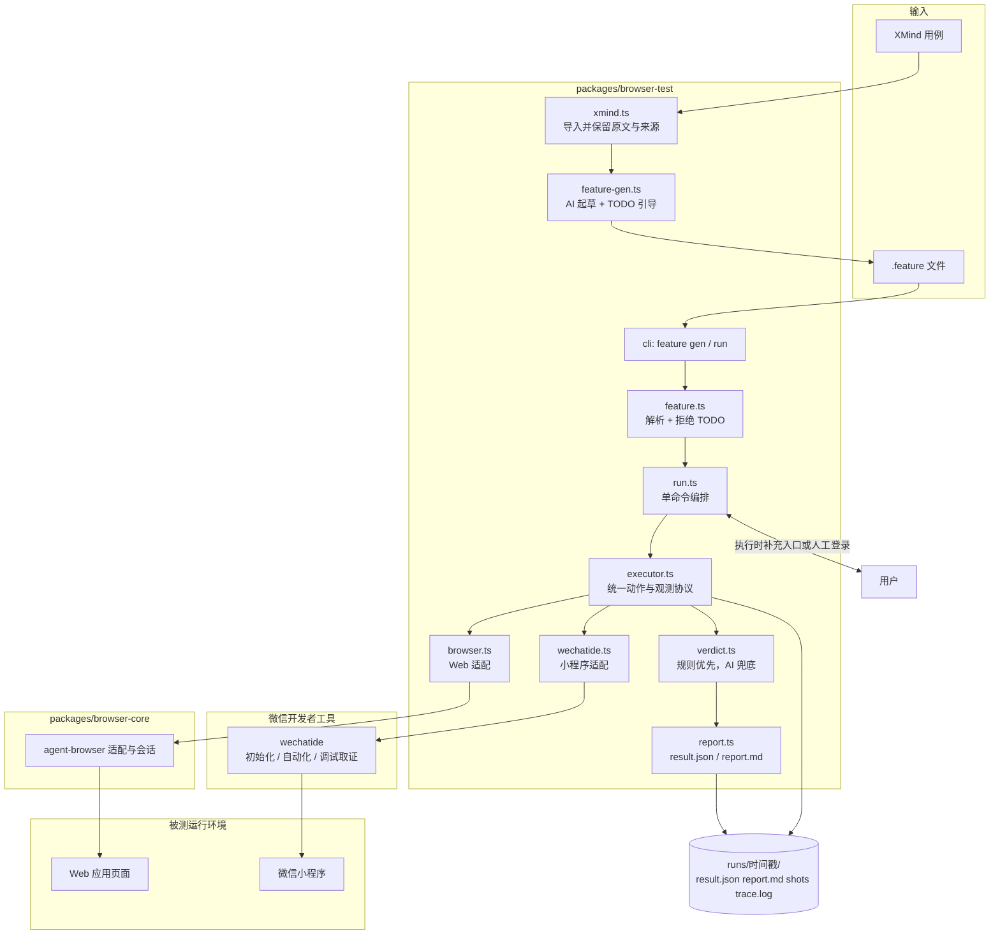
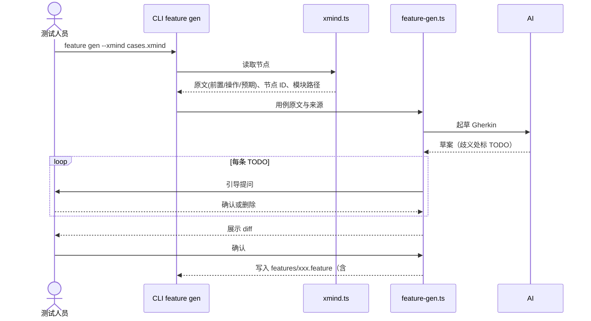
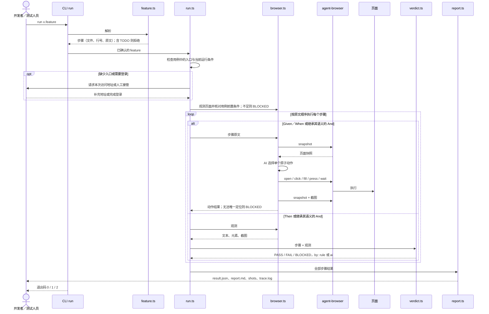
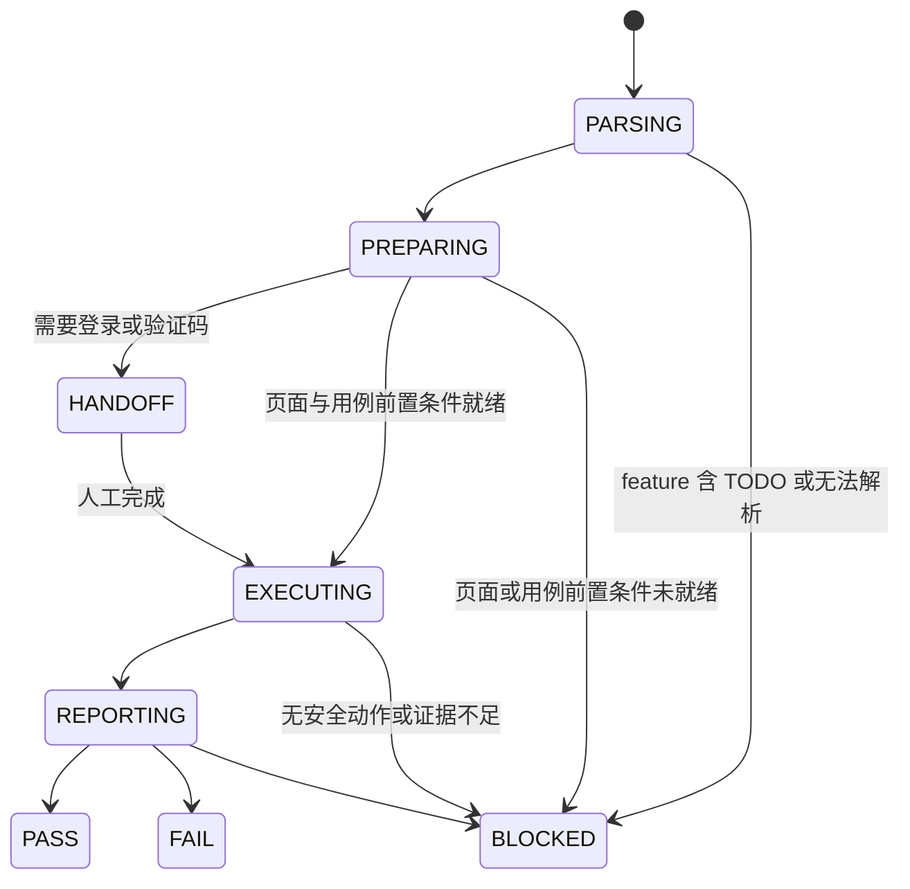

# browser-test 技术设计：Gherkin 驱动的 Web 与微信小程序测试

> 本文是 `browser-test` 的目标设计，也是从零实现的路线图。当前按“用户仅持有 XMind 用例”重新收敛范围。此前的项目预设类型、校验与读取代码已移除，已完成第 1 步 XMind 导入，可使用 `xmind list --xmind <文件> [--json]`；格式与识别边界见包 README。其余能力按第 9 章逐步实现，实现前不能当作现有 CLI 的使用说明。

## 1. 背景与目标

Web 应用与微信小程序测试用例以 XMind 维护，开发联调和问题回归更适合直接运行可读的 Gherkin。把每条用例改写成测试代码接入成本高；纯自然语言 UI 执行又缺少稳定的数据、明确的断言口径和可信的结果。

`browser-test` 的起点是：**用户手上只有一个包含测试用例的 XMind 文件**。先导入并确认用例，再执行并输出报告，不要求访问业务仓库或准备项目配置。

- XMind 用例经 AI 引导生成并由人确认，落成 `.feature`。
- 运行时由 AI 读取步骤，Web 通过 agent-browser、小程序通过微信开发者工具 `wechatide` 在真实运行时中操作和观测。
- 确定性规则优先判定，AI 只负责动作选择和规则无法覆盖的局部语义判断；证据不足一律 BLOCKED。

核心原则：

- `.feature` 是唯一执行入口，步骤原文即断言口径，运行器不得改写步骤或放宽预期。
- 每次运行记录 feature 摘要、实际执行入口、运行平台和用户补充的信息来源，结论只引用本次运行的实际页面证据。
- 操作前后均观测；写操作失败或结果不明时不自动重试。
- 环境、登录、用例数据前提或证据不满足时停止，并输出明确的阻塞原因。
- 默认产物只服务复现和排查，不预生成中间资产。

### 1.1 支持范围

聚焦 Web 应用 和微信开发者工具模拟器中的小程序。APP 用例可导入，但标记为不支持。

首期先打通 Web 的只读用例闭环，再接入已在微信开发者工具中运行的小程序。执行使用现有环境，工具不要求接入 mock 或修改业务代码。Web 与小程序交互或预期不同时使用独立 Scenario，不为跨端复用放宽断言。

用户无需预先提供路由、应用映射、源码路径或登录态文件。XMind 中已有的信息原样保留；执行时缺少入口或登录条件，再按当前步骤请求补充或人工接管。工具和运行环境的安装仍属于执行能力准备，不属于业务项目配置。

### 1.2 非目标

- 不引入 Cucumber 运行时和 step definition 代码。
- 不改变 `browser-opt` 的 Workflow 行为，不做 XMind 与 Workflow 的互转。
- 不恢复 `browser-e2e` 测试代码生成，不建设替代真实系统的演示业务系统。
- 当前不设计或接入 `project.json`、业务路由源码解析、路由表、URL 拼接规则、应用与环境预设、mock 场景配置；后续有实际效率需求时再评估。
- 不预先建设 PageModel、ExecutionPlan、数据清单、checkpoint 和批量执行；出现真实需求后再独立评估。
- 首期小程序范围限定为微信开发者工具模拟器，不把模拟器结论等同于真机微信、原生授权或设备能力验证。

## 2. 总体架构



| 位置 | 职责 |
| --- | --- |
| `packages/browser-test` | feature 生成与解析、运行编排、Web／小程序执行适配、判定、报告、CLI |
| `packages/browser-core` | agent-browser 适配、浏览器启动与会话等通用底层，构建时编译进各 CLI 的 `dist/browser-core`，不独立发布 |
| `packages/browser-opt` | 自然语言操作与 Workflow，保持现有边界 |
| `packages/browser-e2e` | 现有测试生成方向代码，本次不扩展 |

`browser-test` 的 Skill 只负责把用户意图映射到当前阶段已经实现的 CLI 能力，不在 Skill 内复制解析或执行逻辑。开发阶段即可把仓库内 Skill 安装或链接到本机 Agent Skills 目录，通过 `/browser-test` 做本地联调；尚未实现的能力必须明确提示当前边界，不能用临时提示词模拟成功。

技术栈：Node.js 24+、TypeScript、ESM、agent-browser、微信开发者工具 `wechatide`；按需引入 Zod（输入与结果校验）和 fflate（读取 XMind ZIP 中的 `content.json`），在对应步骤实现时再加入依赖。AI 调用经 Vercel AI Gateway。`wechatide` 按[微信开发者工具 Skills 官方文档](https://developers.weixin.qq.com/miniprogram/dev/devtools/Skills.html)接入，运行时读取当前安装版本随附的 Skill 和工具参数，不在包内复制固定工具清单。

## 3. 端到端时序

### 3.1 生成：XMind → .feature



### 3.2 执行：run（Web 示例）



### 3.3 执行：run（微信小程序）

小程序沿用相同的解析、逐步执行、判定与报告流程，只替换环境准备和执行适配器：

1. `wechatide.ts` 先调用 `check_devtools_status`，`--skill-version` 取自当前安装 `skill.yaml` 的 `version`；返回 `openid` 且无 `warning` 才继续，同一运行中不重复检查。同时校验开发者工具不低于 Nightly Electron Build 2.02.2607032，服务端口已开启；未登录或首次 `clientName` 授权弹窗进入 HANDOFF，未确认前不执行其他工具。
2. 连接用户已打开的小程序，通过运行时信息核对当前项目、页面和运行时；未打开目标项目或无法确认时，请用户打开或确认后继续。不读取业务源码或要求配置项目路径映射。
3. 在现有环境中核对用例的数据前提，缺少数据时 BLOCKED，不自动构造 mock 或修改业务工程。
4. 页面操作使用 automator 的导航、页面、元素和视口类工具；每个动作前后重新查询页面和目标元素。工具名与参数以安装包 `miniprogram-tools/references/tools.yaml` 的 `inputSchema` 为准，不凭记忆编写。
5. 失败时按需通过 debugger 类工具读取 console、network 并截图补充证据，不以刷新或重试掩盖原始失败。模拟器可见不等于业务页面可用，进入步骤前须核对页面实际状态。

`browser-test` 运行器以命令行调用 `wechatide`（`-c <clientName> -t <tool> --<field> value`，object／array 参数通过 `--<field>-file` 传 JSON 文件，运行后清理临时文件），确保每次调用的工具和参数明确；`wechatide` 返回 `pending + taskId` 时保留任务信息并遵守官方异步任务协议。交互式 Agent 可按下方配置通过 MCP 直接使用同一组 DevTools 能力。登录等会阻塞执行的任务进入 HANDOFF；写操作、上传等动作不因超时或状态未知而重复发起。

### Agent MCP 配置（Copilot 与 Codex）

微信开发者工具 MCP 通过本机 `wechatide mcp` stdio 命令连接。先安装 Nightly Electron Build 2.02.2607032 或更新版本，登录开发者工具并开启服务端口，再到「设置 → 安全」复制带 Token 的配置；MCP Token 与 CLI 访问令牌、`clientName` 授权相互独立。首次连接仍需在开发者工具中授权对应 Agent。

- VS Code Copilot 使用仓库内 `.vscode/mcp.json`。配置会在连接时安全提示输入 MCP Token，不会把 Token 保存到仓库；若系统找不到 `wechatide`，将 `command` 改为终端中 `which wechatide` 返回的绝对路径。
- Codex 使用本机 `~/.codex/config.toml` 中的 `mcp_servers` 配置，不要把个人 Token 写入项目配置或提交到 Git。若该文件已存在 `wechat-devtools`，更新该项而不是重复添加；配置结构以微信开发者工具设置页复制内容为准。
- Copilot 与 Codex 使用相同的本机 DevTools 服务和授权，但各自读取不同的配置文件。修改配置后重载 VS Code 或重启 Codex 会话。

此 MCP 配置用于交互式 Agent 操作，不改变 `browser-test` 运行器优先通过 `wechatide` CLI 执行可复现用例的设计。

## 4. Feature 协议

### 4.1 生成规则

1. 导入：读取 XMind 节点的前置条件、操作、预期、节点 ID 和模块路径，保留原文，不改写。
2. 起草：前置条件 → Given，操作 → When，每条预期拆成独立 Then／And，模块路径 → Feature 名，数据前提保留为自然语言 Given。
3. 页面描述：保留用例中的应用名称、页面名称和导航操作；原文有 URL 时保留，没有时不补造地址、不读取路由源码，也不要求用户填写路径。
4. 引导确认：只确认用例语义、操作和预期中的歧义，留下 `# TODO(确认): …` 并逐条提问。缺少执行地址不阻塞生成，也不因此添加 TODO；运行条件在执行时补充。
5. 落盘：人工看 diff 后确认；文件头保留来源节点，便于回溯。

```gherkin
# source: cases.xmind#node-7f3a  商品管理/产品服务类型维护/列表页面
Feature: 产品服务类型列表

  Scenario: 列表页面字段与按钮展示校验
    Given 已登录应用 A
    And 打开【商品管理-产品服务类型维护】页面
    And 页面存在已有的类型数据
    When 查看列表页面
    Then 列表展示“类型名称”“关联前台类目”“须上传资质文件数量”
    And 页面存在【新增】按钮
    And 每条记录存在【编辑】【删除】按钮
    # TODO(确认): “按钮具备停用操作”含义不明确，确认后改写为具体步骤或删除
```

约束：

- 含 `# TODO(确认)` 的 feature，`run` 拒绝执行并提示位置。
- 一条预期对应一个 Then／And，报告可逐条定位。
- 生成只依赖 XMind 原文和用户对用例语义的确认，不读取业务仓库、不要求场景清单，也不探查页面。元素定位留给执行阶段。
- 一份 XMind 可覆盖多个应用，保留原文应用名称并按业务模块组织 feature，不要求预先注册应用标识或给整份 XMind 绑定地址。
- `.feature` 保存到调用方指定目录，不要求业务仓库；人工修改以它为准；XMind 更新后重新生成只输出差异，不覆盖已确认文件。
- 开发者也可以直接编写 feature，不必经过 XMind。

### 4.2 解析与来源定位

运行器解析 Feature、Scenario、Given、When、Then、And 和标签，每个步骤保留文件、行号与原文。

XMind 用例不定义独立的 `caseId`。原文已有编号时，它仍作为主题标题或原始节点内容保留，但不提升为必填字段或 `@case` 标签；原文缺失编号时不自动生成。生成文件通过 `# source: <文件>#<节点 ID>` 记录来源，导入结果通过文件、画布 ID 和节点 ID 定位原始主题。

本阶段不引入 application、target 或数据场景标签作为执行前提；已有探索性标签不代表本阶段支持对应能力，解析时须明确提示尚不支持，不能静默忽略其语义。

### 4.3 执行时获取必要信息

1. 生成阶段保留“打开商品管理”等自然语言描述，不把它转换为路由配置。
2. 执行阶段使用用例中明确的完整 URL，或向用户请求本次访问地址；不从应用名称猜测域名，不拼接 hash／history 路由。用户可直接提供目标页面完整地址。
3. 进入应用后，根据页面实际可见的菜单、链接和按钮导航；无法唯一确定时展示候选并请求确认，无法继续则 BLOCKED。
4. 登录或验证码需要人工操作时进入 HANDOFF；恢复后重新观测并核对登录结果，不要求用户预先制作登录态文件。
5. 非交互执行缺少必要信息时 BLOCKED，并说明缺少什么。只提供 XMind 足以开始导入与生成，不代表能无条件完成执行。
6. 报告记录本次实际访问地址、平台及用户补充信息的来源，不自动保存为项目预设。首期每个场景只执行一个应用，跨应用场景明确 BLOCKED。

## 5. 运行时执行

### 5.1 动作规划

每个 Given／When 采用“观测 → 选择动作 → 执行单个原子动作 → 再观测”。执行器向 AI 提供统一的页面、候选元素和截图证据，再把动作映射到平台能力：

- Web 优先使用 URL、唯一文本、role、label 或 test id，执行 agent-browser 的 open、click、fill、press、wait 或 scroll。
- 小程序优先使用稳定测试标识、唯一选择器、文本和组件范围，执行 `wechatide` 的导航、元素操作、页面查询与滚动工具。普通页面与 tabBar 页面按各自导航能力处理。

无法唯一定位时 BLOCKED，并展示候选和截图，不允许猜测点击。每步重新获取观测，不依赖上一步的元素 ref 或 selector 查询结果。`page.data` 等内部状态可以辅助定位问题，但不能替代页面文本、元素状态或截图作为界面断言证据。

### 5.2 Then 判定

Then 只观测和判断，不产生业务写操作。

- 文本、数量、URL、可见性和结构化字段优先用确定性规则判定（`by: rule`）。
- 规则无法覆盖时由 AI 判断并标注 `by: ai`，报告单独高亮供人复核。
- 每个 Then 记录实际观测和截图；证据不足为 BLOCKED。
- 确定性 FAIL 不能被 AI 覆盖。

### 5.3 写操作与环境

- 首期仅执行只读用例；遇到提交、删除等业务写操作明确 BLOCKED。后续根据实际使用需求单独设计写操作支持。
- 写操作结果不明时停止，不自动重试。
- Web 登录、验证码或微信开发者工具登录需要人工完成时进入 HANDOFF，人工完成后继续，不形成额外结果类型；不同应用和环境的会话不混用。微信业务登录、微信开发者工具登录和用户授权分别记录，不互相替代。

### 5.4 运行状态



结论只有 `PASS / FAIL / BLOCKED`。首期不建设 checkpoint，中断后重新检查环境与前置条件，再运行相同 feature；不承诺现有环境的数据可确定性复现。

## 6. 用例前置条件与后续评估

XMind 中的业务前置条件仍须保留并在执行时核对，例如“已登录”“存在三条待审核记录”。取消工具的前置配置，不等于跳过用例前置条件。

- 使用页面实际证据核对当前数据，无法确认则 BLOCKED。
- 数据不足时说明缺少的条件，由用户准备后重新执行；不将预期改写为适应当前页面的数据。
- 本阶段不引入 mocks 包、fixture、scenarioId、reset 端点或 seed，也不要求修改业务源码。
- 项目预设、路由辅助、登录态预设和可复现数据场景均暂缓；在实际使用中确认重复补充信息成为效率问题后，再评估必要性与接入边界，当前不制定其配置协议。

## 7. 命令、产物与退出码

```bash
browser-test feature gen --xmind cases.xmind --out features/
browser-test run features/service-type-list.feature
```

本地开发从第 2 步开始同时提供 Skill 调用入口。安装或链接仓库内 Skill 后，可在支持 Skills 的 Agent 中使用 `/browser-test` 加自然语言请求；Skill 将请求转换为同一套 `browser-test` CLI 命令。CLI 是唯一功能实现入口，Skill 联调不维护另一套业务逻辑。

执行输出示例：

```text
[1/3] Given 已登录并打开…页面   页面导航并核对前置条件   ok   shots/01.png
[2/3] When  查看列表            agent-browser snapshot                      ok   shots/02.png
[3/3] Then  …三列               PASS  表头: 类型名称 | 关联前台类目 | 须上传资质文件数量 | 操作
      And   【新增】按钮         PASS  button "新增" (e12)
      And   每条记录【编辑】【删除】  FAIL  第 3 行缺少“删除”   shots/03.png

Result: FAIL (2 passed, 1 failed)   report: runs/20261013-1612/report.md
```

运行目录只保留四类产物：

```text
runs/20261013-1612/
├── result.json   # 每步：text / status / by(rule|ai|action) / evidence / 耗时
├── report.md     # 人读：失败步骤置顶，附截图、实际文本、复现命令
├── shots/        # 01.png 02.png …（失败步骤必有）
└── trace.log     # agent-browser／wechatide 命令与用户补充信息的记录（不含凭证）
```

```json
{
  "feature": "features/service-type-list.feature",
  "environment": { "url": "https://example.com/products", "source": "user-input" },
  "platform": "web",
  "runtime": "browser",
  "status": "FAIL",
  "steps": [
    { "text": "Given 已登录并打开…页面", "status": "PASS", "by": "action", "shot": "shots/01.png" },
    { "text": "Then 列表展示…三列", "status": "PASS", "by": "rule", "actual": ["类型名称", "关联前台类目", "须上传资质文件数量", "操作"], "shot": "shots/02.png" },
    { "text": "And 每条记录都有【编辑】【删除】按钮", "status": "FAIL", "by": "rule", "actual": "第 3 行仅有【编辑】", "shot": "shots/03.png" }
  ],
  "rerun": "browser-test run features/service-type-list.feature"
}
```

小程序结果使用相同结构，并在 `environment` 中记录项目路径摘要、当前页、Skill 版本关系、开发者工具版本、基础库版本和构建标识。无法取得的字段明确记为 unavailable，不推断或伪造；`runtime` 固定记录为 `devtools`，避免把模拟器结果误认为真机结果。

排查路径：看 `report.md` 的失败步骤 → 看截图与 `actual` → 需要时查 `trace.log`。退出码：`0 = PASS`，`1 = FAIL`，`2 = BLOCKED 或工具错误`。

## 8. 目标代码结构

| 模块 | 职责 |
| --- | --- |
| `types.ts` | 随实际实现定义 XMind 节点、Feature、Step、动作与结果类型，不预定义项目配置类型 |
| `xmind.ts` | 读取 XMind，保留原文、节点 ID、模块路径 |
| `feature-gen.ts` | 仅根据 XMind 原文起草 Gherkin，保留页面自然语言描述、`# source` 与用例语义的 TODO 引导 |
| `feature.ts` | 解析 Gherkin，保留文件与行号；拒绝含 TODO 的 feature |
| `executor.ts` | 定义跨平台的原子动作、页面观测、截图和执行结果协议 |
| `browser.ts` | 通过 browser-core 执行原子动作，采集快照与截图 |
| `wechatide.ts` | 调用微信开发者工具官方 Skills，完成环境门禁、小程序操作、观测与调试取证 |
| `verdict.ts` | 确定性规则优先，AI 判断兜底，统一输出 PASS／FAIL／BLOCKED |
| `report.ts` | 生成 `result.json`、`report.md` 与失败步骤摘要 |
| `run.ts` | 单命令串联解析、目标准备、执行、判定与报告 |
| `cli/browser-test.ts` | 命令入口与退出码 |
| `skills/browser-test/SKILL.md` | 面向 Agent 的调用说明、能力边界与 CLI 映射；用于从第 2 步开始的本地联调 |

## 9. 实施步骤与验收

按顺序实现，每一步独立可验收；前一步未通过不进入下一步。

| 步骤 | 实现内容 | 最小验收 |
| --- | --- | --- |
| 1（已实现） | `xmind.ts`：XMind 导入及 `xmind list` CLI | 只提供 XMind 即可列出用例，保留原文、层级、节点 ID 与来源；无业务仓库、无配置文件也能完成 |
| 2 | Skill 调用入口与本地联调骨架 | 仓库内提供可安装或链接的 `browser-test` Skill；通过 `/browser-test` 可调用第 1 步的 `xmind list`，调用尚未实现的命令时明确说明能力边界；Skill 与 CLI 参数映射可在发布前持续联调 |
| 3 | `feature-gen.ts`：引导生成 | 仅用 XMind 生成草案并确认语义；页面名称保留为自然语言；不要求路由、应用注册或 mock 清单；Skill 可调用该能力 |
| 4 | `feature.ts`：Gherkin 解析与 TODO 拒绝 | 步骤带行号，含语义 TODO 被拒绝；无 URL 的合法用例可解析；Skill 可验证拒绝提示与定位信息 |
| 5 | `executor.ts`、`browser.ts` 与最小报告 | 执行时请求缺失地址，通过可见页面导航并观测；无法唯一定位则 BLOCKED；产出实际截图与结果 |
| 6 | `verdict.ts`、`run.ts`：Web 只读闭环与 HANDOFF | XMind → feature → 页面执行 → 报告完整打通；登录可接管，数据不足与非交互缺入口明确 BLOCKED；退出码正确 |
| 7 | `wechatide.ts`：已打开小程序的只读流程 | 不读取业务源码，核对当前项目与页面，完成操作、观测、判定和报告；运行环境不符则阻塞或接管 |
| 8 | 完善 Skill、发布与文档 | 固化安装、升级和调用说明，完成发布包校验；AI 助手可从用户提供的 XMind 开始，按需补充运行信息完成 Web／小程序用例闭环 |

首个闭环选择 XMind 中一个单应用的只读列表用例，使用已有可访问页面，打通 `XMind → feature → agent-browser → report`。验收必须覆盖实际 PASS、可观察的不满足预期时 FAIL，以及入口、数据或定位不足时 BLOCKED；可用工具自身的测试页面验证失败分支，不要求被测业务接入 fixture。小程序随后复用相同协议接入用户已打开的运行环境。仅有解析结果、类型定义、命令成功或模拟报告不算闭环完成。

## 10. 测试策略与风险控制

测试优先覆盖：XMind 原文保留、无配置生成、feature 解析与 TODO 拒绝、执行时信息补充、跨平台动作编排、Then 判定、报告结构与退出码，每一步实现时同步补充。

| 风险 | 控制 |
| --- | --- |
| 自然语言含义不明确 | 报告原文、候选和截图并 BLOCKED；稳定后再沉淀规则 |
| `wechatide` 版本或工具参数变化 | 每次运行读取安装包随附 Skill；先检查 `versionRelation`，不在代码中写死未验证参数 |
| 小程序自定义组件无法稳定定位 | 按实际页面观测限定候选；无法唯一定位或不可见时 BLOCKED，不要求改业务代码 |
| 模拟器通过被当成真机通过 | 报告记录 runtime 为 devtools；授权、原生组件和设备能力另做真机验证 |
| 页面缺陷被固化为预期 | 预期只来自 feature；页面实际结果只作为 actual |
| 页面元素 ref 变化 | 每步重新获取快照，优先 role、label、test id 与唯一文本 |
| 模型误判 | 确定性规则优先；AI 结论标注来源并保留证据 |
| 重复提交 | 写动作不自动重试；结果不明立即 BLOCKED |
| 产物膨胀 | 运行目录固定四类产物；新增资产必须证明排查确有需要 |

建设顺序固定为：先完成无配置的 XMind 导入，再建立 Skill 调用入口用于逐步本地联调，然后完成用例确认并打通 Web 只读执行闭环，随后接入已运行的小程序。路由、预设、mock 与跨系统能力不列入本阶段验收。工程验收要求对应的类型检查、构建和测试通过，且不影响现有 browser-opt 命令、Workflow 与发布流程。
