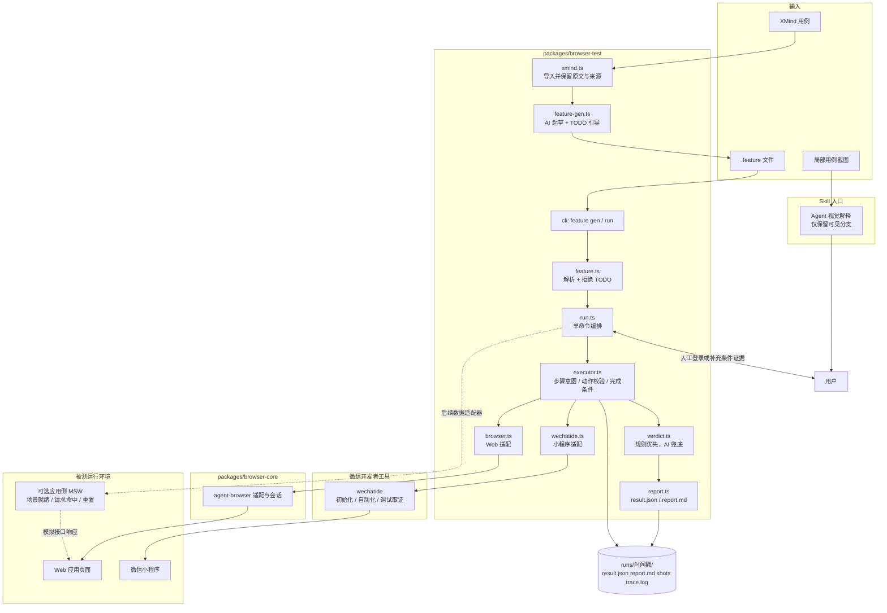
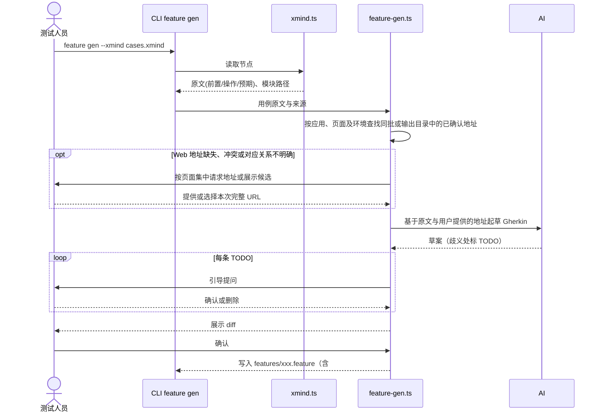
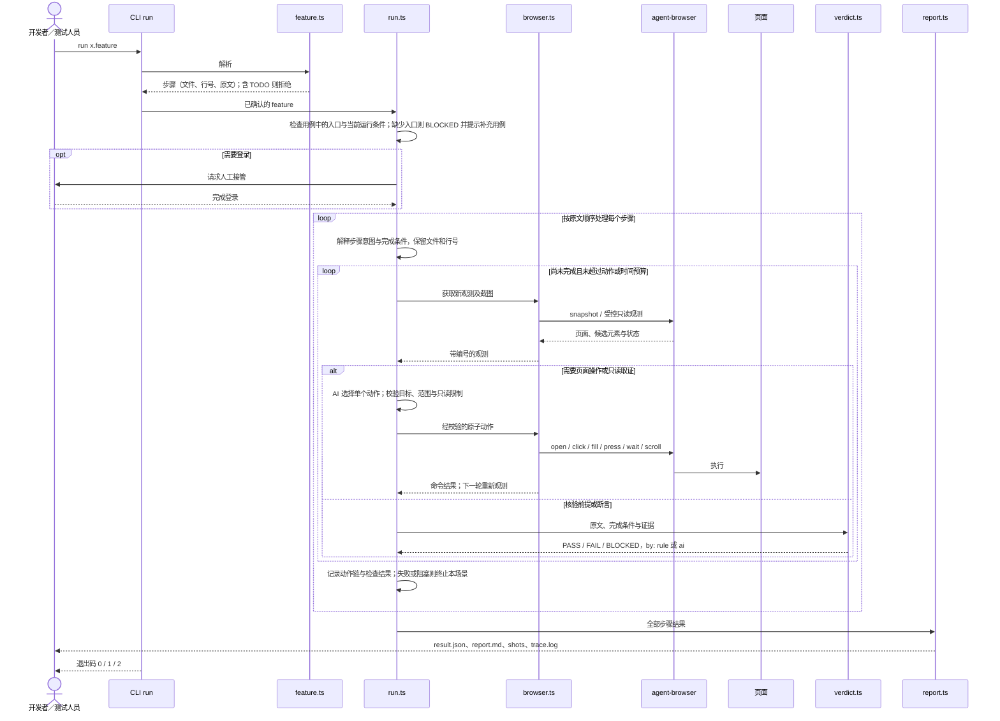
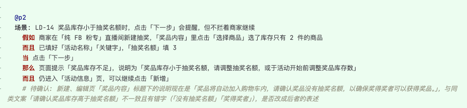
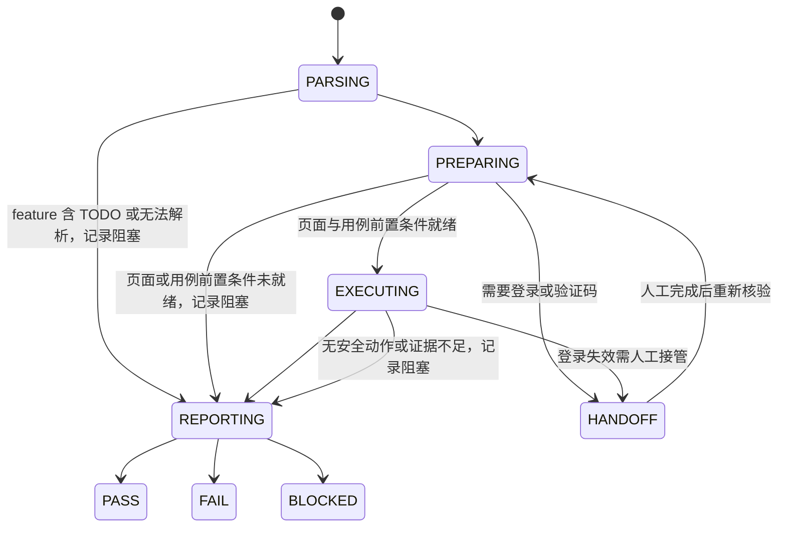

# browser-test 技术设计：Gherkin 驱动的 Web 与微信小程序测试

> 本文是 `browser-test` 的目标设计，也是从零实现的路线图。当前按“用户仅持有 XMind 用例，或用截图从大型 XMind 中选取了局部用例”重新收敛范围。此前的项目预设类型、校验与读取代码已移除，已完成第 1 步 XMind 导入、第 2 步 Skill 调用入口与本地联调骨架、第 3 步引导生成和第 4 步 Gherkin 解析与待确认项拒绝：XMind 可使用 `xmind list --xmind <文件> [--json]`，局部用例截图由 Skill 中的 Agent 直接解释。格式、识别边界和 Skill 安装方式见包 README 及开发记录。其余能力按第 9 章逐步实现，实现前不能当作现有 CLI 的使用说明。

## 1. 背景与目标

Web 应用与微信小程序测试用例以 XMind 维护，开发联调和问题回归更适合直接运行可读的 Gherkin。把每条用例改写成测试代码接入成本高；纯自然语言 UI 执行又缺少稳定的数据、明确的断言口径和可信的结果。

`browser-test` 的起点是：**用户手上只有一个包含测试用例的 XMind 文件，或者从其中截取的局部用例图片**。先导入或解释并确认用例，再执行并输出报告，不要求访问业务仓库或准备项目配置。

- XMind 用例经 AI 引导生成并由人确认，落成 `.feature`。
- 运行时由 AI 读取步骤，Web 通过 agent-browser、小程序通过微信开发者工具 `wechatide` 在真实运行时中操作和观测。
- 确定性规则优先判定，AI 只负责动作选择和规则无法覆盖的局部语义判断；证据不足一律 BLOCKED。

核心原则：

- `.feature` 是唯一执行入口，步骤原文即断言口径，运行器不得改写步骤或放宽预期。
- 每次运行记录 feature 摘要、实际执行入口、运行平台和用户补充的信息来源，界面结论只引用本次运行的实际页面证据，数据前提另行记录可核验的数据来源。
- 操作前后均观测；写操作失败或结果不明时不自动重试。
- 环境、登录、用例数据前提或证据不满足时停止，并输出明确的阻塞原因。
- 默认产物只服务复现和排查，不预生成中间资产。

### 1.1 支持范围

聚焦 Web 应用 和微信开发者工具模拟器中的小程序。APP 用例可导入，但标记为不支持。

首期先打通 Web 的只读用例闭环，再接入已在微信开发者工具中运行的小程序。执行使用现有环境，工具不要求接入 mock 或修改业务代码。Web 与小程序交互或预期不同时使用独立 Scenario，不为跨端复用放宽断言。

用户无需预先提供路由、应用映射、源码路径或登录态文件。XMind 中已有的信息原样保留；生成 Web 用例时，若原文没有明确的完整 URL，先复用同批或指定输出目录中已有用例的已确认地址，仅在缺失或冲突时集中向用户提问，并随用例确认。执行时核对已确认的入口，缺少登录条件时请求人工接管。工具和运行环境的安装仍属于执行能力准备，不属于业务项目配置。

### 1.2 非目标

- 不引入 Cucumber 运行时和 step definition 代码。
- 不改变 `browser-opt` 的 Workflow 行为，不做 XMind 与 Workflow 的互转。
- 不恢复 `browser-e2e` 测试代码生成，不建设替代真实系统的演示业务系统。
- 当前不设计或接入 `project.json`、业务路由源码解析、路由表、URL 拼接规则、应用与环境预设。MSW 场景绑定仅作第 6 章的可选后续设计，不纳入首期实现。
- 不预先建设 PageModel、ExecutionPlan、数据清单、checkpoint 和跨文件批量执行；出现真实需求后再独立评估。
- 首期小程序范围限定为微信开发者工具模拟器，不把模拟器结论等同于真机微信、原生授权或设备能力验证。

## 2. 总体架构



| 位置 | 职责 |
| --- | --- |
| `packages/browser-test` | feature 生成与解析、运行编排、Web／小程序执行适配、判定、报告、CLI |
| `packages/browser-core` | agent-browser 适配、浏览器启动与会话等通用底层，构建时编译进各 CLI 的 `dist/browser-core`，不独立发布 |
| `packages/browser-opt` | 自然语言操作与 Workflow，保持现有边界 |
| `packages/browser-e2e` | 现有测试生成方向代码，本次不扩展 |

`browser-test` 的 Skill 负责把 XMind 意图映射到当前阶段已经实现的 CLI 能力，不在 Skill 内复制 XMind 解析或执行逻辑。局部用例截图例外地由 Agent 直接解释，因为它们是对话中的用例选择介质，不是 CLI 可导入的 XMind 结构化文件；解释只保留可见层级和原文，裁切或模糊信息显式标记待确认。开发阶段即可把仓库内 Skill 安装或链接到本机 Agent Skills 目录，通过 `/browser-test` 做本地联调；尚未实现的能力必须明确提示当前边界，不能用临时提示词模拟成功。

技术栈：Node.js 24+、TypeScript、ESM、agent-browser、微信开发者工具 `wechatide`；按需引入 Zod（输入与结果校验）和 fflate（读取 XMind ZIP 中的 `content.json`），在对应步骤实现时再加入依赖。AI 调用经 Vercel AI Gateway。`wechatide` 按[微信开发者工具 Skills 官方文档](https://developers.weixin.qq.com/miniprogram/dev/devtools/Skills.html)接入，运行时读取当前安装版本随附的 Skill 和工具参数，不在包内复制固定工具清单。

## 3. 端到端时序

### 3.1 生成：XMind → .feature



### 3.2 执行：run（Web 示例）



### 3.3 执行：run（微信小程序）

小程序沿用相同的解析、逐步执行、判定与报告流程，只替换环境准备和执行适配器：

1. `wechatide.ts` 先调用 `check_devtools_status`，`--skill-version` 取自当前安装 `skill.yaml` 的 `version`；返回 `openid` 且无 `warning` 才继续，同一运行中不重复检查。同时校验开发者工具不低于 Nightly Electron Build 2.02.2607032，服务端口已开启；未登录或首次 `clientName` 授权弹窗进入 HANDOFF，未确认前不执行其他工具。
2. 连接用户已打开的小程序，通过运行时信息核对当前项目、页面和运行时；未打开目标项目或无法确认时，请用户打开或确认后继续。不读取业务源码或要求配置项目路径映射。
3. 在现有环境中核对用例的数据前提，缺少数据时 BLOCKED，不自动构造 mock 或修改业务工程。
4. 页面操作使用 automator 的导航、页面、元素和视口类工具；每个动作前后重新查询页面和目标元素。工具名与参数以安装包 `miniprogram-tools/references/tools.yaml` 的 `inputSchema` 为准，不凭记忆编写。
5. 失败时按需通过 debugger 类工具读取 console、network 并截图补充证据，不以刷新或重试掩盖原始失败。模拟器可见不等于业务页面可用，进入步骤前须核对页面实际状态。

`browser-test` 运行器以命令行调用 `wechatide`（`-c <clientName> -t <tool> --<field> value`，object／array 参数通过 `--<field>-file` 传 JSON 文件，运行后清理临时文件），确保每次调用的工具和参数明确；`wechatide` 返回 `pending + taskId` 时保留任务信息并遵守官方异步任务协议。交互式 Agent 可按下方配置通过 MCP 直接使用同一组 DevTools 能力。登录等会阻塞执行的任务进入 HANDOFF；写操作、上传等动作不因超时或状态未知而重复发起。

### Agent MCP 配置（Copilot 与 Codex）

微信开发者工具 MCP 通过本机 `wechatide mcp` stdio 命令连接。先安装 Nightly Electron Build 2.02.2607032 或更新版本，登录开发者工具并开启服务端口，再到「设置 → 安全」复制带 Token 的配置；MCP Token 与 CLI 访问令牌、`clientName` 授权相互独立。首次连接仍需在开发者工具中授权对应 Agent。

- VS Code Copilot 使用仓库内 `.vscode/mcp.json`。配置会在连接时安全提示输入 MCP Token，不会把 Token 保存到仓库；若系统找不到 `wechatide`，将 `command` 改为终端中 `which wechatide` 返回的绝对路径。
- Codex 使用本机 `~/.codex/config.toml` 中的 `mcp_servers` 配置，不要把个人 Token 写入项目配置或提交到 Git。若该文件已存在 `wechat-devtools`，更新该项而不是重复添加；配置结构以微信开发者工具设置页复制内容为准。
- Copilot 与 Codex 使用相同的本机 DevTools 服务和授权，但各自读取不同的配置文件。修改配置后重载 VS Code 或重启 Codex 会话。

此 MCP 配置用于交互式 Agent 操作，不改变 `browser-test` 运行器优先通过 `wechatide` CLI 执行可复现用例的设计。

## 4. Feature 协议

### 4.1 生成规则

1. 导入：读取 XMind 节点的前置条件、操作、预期和模块路径，保留原文，不改写。
2. 起草：前置条件 → Given，操作 → When，每条预期拆成独立 Then／And，模块路径 → Feature 名，数据前提保留为自然语言 Given。
3. 页面描述：保留用例中的应用名称、页面名称和导航操作；原文有明确的完整 URL 时保留；Web 用例缺少地址时，按 4.3.1 先复用已确认地址；无法唯一确定时，在生成阶段集中向用户请求或确认本次访问的完整 URL，可提供应用入口或目标页面地址。用户补充的地址作为 Given 前置条件写入对应场景，并注明由用户提供；不补造地址、不读取路由源码。
4. 引导确认：默认确认用例语义、操作和预期中的歧义，以及用户补充的访问地址，留下 `# TODO(确认): …` 并逐条提问。也可选择直接生成模式，一次性写出含待确认注释的 `.feature`，由调用方整文件修改。Web 用例缺少访问地址时可保留待确认草案或直接生成文件，并添加地址待确认 TODO；补齐地址后才能执行。登录等运行条件在执行时核对。
5. 落盘：人工看 diff 后确认；文件头保留来源文件与模块路径（标题见 Scenario），便于回溯。

```gherkin
# source: cases.xmind / 商品管理 / 产品服务类型维护 / 列表页面
Feature: 产品服务类型列表

  Scenario: 列表页面字段与按钮展示校验
    # 访问地址由用户在生成阶段提供
    Given 本次访问地址为 "https://example.com/"
    And 已登录应用 A
    And 打开【商品管理-产品服务类型维护】页面
    And 页面存在已有的类型数据
    When 查看列表页面
    Then 列表展示“类型名称”“关联前台类目”“须上传资质文件数量”
    And 页面存在【新增】按钮
    And 每条记录存在【编辑】【删除】按钮
    # TODO(确认): “按钮具备停用操作”含义不明确，确认后改写为具体步骤或删除
```

约束：

- 含 `# TODO(确认)` 的 feature，`run` 拒绝执行并提示位置。
- 直接生成模式不经过逐项确认，也不把含 TODO 的文件视为已确认；它只将确认工作转为调用方整文件编辑。
- 一条预期对应一个 Then／And，报告可逐条定位。
- 生成只依赖 XMind 原文、同批或指定输出目录中已有用例的已确认地址、用户补充的信息和对用例语义的确认，不读取业务仓库、不要求场景清单，也不探查页面。元素定位留给执行阶段。
- 一份 XMind 可覆盖多个应用，保留原文应用名称并按业务模块组织 feature，不要求预先注册应用标识或给整份 XMind 绑定地址。
- `.feature` 保存到调用方指定目录，不要求业务仓库；人工修改以它为准；XMind 更新后重新生成只输出差异，不覆盖已确认文件。
- 开发者也可以直接编写 feature，不必经过 XMind。

### 4.1.1 输出内容范围（以示例图为准）

最终 Gherkin 的内容范围以下图为准：



图中只出现以下内容元素，生成与解析都不得扩展到额外业务字段。图片中的中文关键字用于表达步骤语义；实际输出的关键字按 Gherkin 语法书写。使用本地化关键字时遵循 Gherkin 对应语言的语法要求。

| 元素 | 图中体现 | 说明 |
|------|----------|------|
| 优先级标签 | `@p2` | 仅来自 XMind 原文的优先级，原文没有则不写 |
| 场景标题 | `场景: LD-14 …` | 原文编号作为标题文本的一部分保留，不拆成独立字段或标签 |
| 步骤 | 假如 / 而且 / 当 / 那么 / 而且 | 表达 Given / And / When / Then / And 的语义；关键字按 Gherkin 语法书写，前置条件、操作、预期按原文拆分，保留页面自然语言描述 |
| 待确认注释 | `# 待确认: …` | 用于用例语义、文案等歧义及缺失的 Web 访问地址，紧跟相关步骤 |

限制：

- 不输出图中没有的字段：`nodeId`、`sheetId`、`caseId`、application、target、数据场景标签、`@case` 等一律不生成。
- 不为追溯引入额外元数据；来源定位依赖文件头 `# source` 注释与场景标题，见 4.2。
- 步骤文字保留原文；用户补充的访问地址以 Given 前置条件记录，并用注释注明来源，不补造 URL、路由、元素定位或断言细节。
- 解析器遇到上述范围之外的标签或字段，按 4.2 提示尚不支持，不静默忽略。
- 待确认注释是 Gherkin 注释，不是额外字段；图中的 `# 待确认` 与 4.1 示例中的 `# TODO(确认)` 都表示待确认内容，运行时必须识别并拒绝执行含待确认项的 feature。

### 4.2 解析与来源定位

运行器解析 Feature、Scenario、Given、When、Then、And 和标签，每个步骤保留文件、行号与原文。

XMind 用例不定义独立的 `caseId`。原文已有编号时，它仍作为主题标题或原始节点内容保留，但不提升为必填字段或 `@case` 标签；原文缺失编号时不自动生成。生成文件通过 `# source: <文件> / <模块路径>` 记录来源（同一模块的用例合并在一个 Feature 内，标题即 Scenario 标题），导入结果通过来源文件、模块路径和标题定位原始主题；同一路径下出现重名用例时应提示。

本阶段不引入 application、target 或数据场景标签作为执行前提；已有探索性标签不代表本阶段支持对应能力，解析时须明确提示尚不支持，不能静默忽略其语义。

### 4.3 生成时确认访问地址与执行时核对条件

1. 生成阶段保留“打开商品管理”等自然语言描述，不把它转换为路由配置。Web 用例没有明确的完整 URL 时，先按 4.3.1 复用已确认地址；缺失或冲突时集中向用户请求或确认本次访问地址，可直接提供应用入口或目标页面完整地址；将地址作为 Given 前置条件写入对应场景并确认，注明用户补充来源。
2. 真实环境执行使用用例中已确认的完整 URL；仅后续显式选择 MSW 模式时允许按 6.3 覆盖为已确认的模拟入口。不再将请求访问地址作为常规执行步骤；缺少地址时 BLOCKED 并提示先补充用例。不从应用名称猜测域名，不拼接 hash／history 路由。
3. 进入应用后，根据页面实际可见的菜单、链接和按钮导航；无法唯一确定时展示候选并请求确认，无法继续则 BLOCKED。
4. 登录或验证码需要人工操作时进入 HANDOFF；恢复后重新观测并核对登录结果，不要求用户预先制作登录态文件。
5. 非交互执行缺少必要信息时 BLOCKED，并说明缺少什么。只提供 XMind 足以开始导入与生成，不代表能无条件完成执行。
6. 报告记录本次实际访问地址、平台及用户补充信息的来源，不自动保存为项目预设。首期每个场景只执行一个应用，跨应用场景明确 BLOCKED。

### 4.3.1 页面地址复用

已有 Gherkin 作为地址记忆来源，首期不新增独立地址配置文件或项目预设。复用只发生在生成阶段，每个生成场景仍写入完整 URL，执行时不依赖其他 feature 文件。

1. 匹配范围：使用“应用名称 + 页面名称”匹配；用例或用户已区分环境时，将环境一起纳入匹配。只读取本次执行目录 `.browser-test/` 中的 `.feature`，不扫描其他项目。应用、环境或页面与地址的对应关系不明确时先确认，不仅凭页面同名自动复用，也不从域名猜测环境。
2. 地址来源：优先保留当前用例明确的完整 URL；缺失时查找本批已确认的对应地址，再查找输出目录中已有用例的已确认地址。已有用例必须明确关联应用、页面和完整 URL；含待确认项的场景、预览草案及仅提到页面名但没有地址的场景不作为自动复用来源。每次生成重新读取文件，以人工修改后的内容为准。
3. 同批复用：将相同应用、页面及环境的地址问题合并提问一次，用户提供或选定后应用于本批所有对应场景。当前用例已写明不同地址时保留原文并展示差异，不静默覆盖。
4. 历史复用与冲突：历史记录只有一个符合条件的地址时直接复用，在生成结果中展示来源文件、场景及受影响用例；存在多个不同地址时列出候选和来源，让用户选择一次或输入新地址。选择仅作用于本批对应场景，不回写历史用例；未解决的冲突保留地址 TODO。
5. 落盘与追溯：复用地址仍作为 Given 前置条件写入每个场景，用 `# 访问页面: …` 注释保存应用、页面、环境、地址和来源，供下次生成核对实际地址步骤；这些是注释中的复用信息，不是执行标签。随整体 diff 确认，不为每个场景重复询问。地址仍缺失时遵循 4.1 的草案与 TODO 规则。
6. CLI 入口：`feature addresses <草案名>` 复用并列出剩余地址分组；加 `--id <编号> --url <完整地址>` 确认整组，身份不明确时同时提供 `--application`、`--page` 和可选的 `--environment`。草案机器状态位于系统临时目录，可读预览与最终 feature 位于本次执行目录的 `.browser-test/`；终端交互生成使用相同逻辑；小程序通过草案的 `platform: "miniprogram"` 跳过 Web 地址确认。

例如，同一应用中的两个用例都进入“供应链商品库管理列表”，分别切换“售卖中”和“待平台售卖”页签：只确认一次列表入口地址，各自的页签操作继续保留。后续生成同一应用、页面及环境的用例时，可直接复用该已确认地址。若现有场景只有页面名称、尚未写入 URL，则首次仍需补充一次。

## 5. 运行时执行

### 5.1 从语法步骤到运行时意图

当前 `feature.ts` 只解析出 `FeatureStep` 的关键字、继承后的语义、原文和文件行号；`run` 随后仍提示执行尚未实现。缺失的是步骤解释、目标绑定、完成条件、数据前提验证和执行证据协议。**解析成功不代表具备执行条件，不能把步骤文本直接交给浏览器后将命令成功当作测试通过。**

目标链路为：`FeatureStep → StepIntent → Observation → ActionDecision → 执行后 Observation → 完成判定 → StepResult`。以下均为待实现设计。

| 意图 | 典型步骤 | 处理方式 |
| --- | --- | --- |
| 入口访问 | Given 本次访问地址为… | 确定性提取已确认 URL，导航并记录实际地址；识别登录跳转 |
| 登录检查 | Given 已登录… | 观测登录状态，必要时人工接管，恢复后复核 |
| 数据前提 | Given 存在…记录 | 核验足以支持原文的数据证据；不自动创建数据 |
| 页面操作 | When 切换到…页签 | 从当前观测选择目标，执行单个动作，再检查是否完成 |
| 页面断言 | Then 展示… | 拆分检查项，观测并判定，不产生业务写操作 |

`And` 使用解析器给出的 `semantic`，不重新猜测所属阶段。Given 可以是检查，When 的“查看”可以只观测；Then 可以有多个检查项。复杂导航允许一个步骤对应多次原子动作，但不能提前执行后续步骤或改写原文要求。解释出的目标与完成条件只细化原文；歧义不能由当前页面的实际内容反向补成预期。

运行时模型沿用 `AI_GATEWAY_API_KEY`、`BROWSER_TEST_MODEL` 和现有网关调用方式；缺少配置时明确 BLOCKED，不隐式改用浏览器自由对话。Skill 只负责调用 CLI。`browser-test` 复用 `browser-core` 的会话、命令、截图和人工接管能力；不直接复用 `browser-opt` 的步骤重试和布尔结果协议，也不扩展旧的 `browser-e2e` 运行器。

### 5.2 最小运行时协议与执行循环

以下类型属于 `browser-test`，不替换 `browser-core` 的同名类型。它们是内存协议；动作链、检查及观测摘要写入已有的 `result.json`、`trace.log` 和 `shots/`，不新增执行计划文件。

```ts
/** 每个解释结果始终关联原步骤；条件是原文的拆分，不是页面反推的预期。 */
interface StepIntent {
  source: { file: string; scenario: string; line: number; original: string };
  semantic: 'Given' | 'When' | 'Then';
  kind: 'entry' | 'login' | 'precondition' | 'interaction' | 'assertion';
  scope: { description: string; entityKey?: string };
  conditions: Array<{ id: string; expected: string; evidenceKind: 'page' | 'data' }>;
}

/** 一次实际观测；目标编号只在该观测有效，业务标识用于重新定位同一条记录。 */
interface Observation {
  id: string;
  capturedAt: string;
  url: string;
  shot?: string;
  targets: Array<{
    id: string; ref: string; role?: string; name: string;
    scope: string; entityKey?: string; visible: boolean;
    states: Record<string, string | boolean | number>;
  }>;
  evidence: Array<{
    id: string; kind: 'page' | 'data'; source: string; actual: unknown;
  }>;
}

/** 模型只能选择受支持的决定；导航地址和元素目标还必须经过宿主校验。 */
type ActionDecision = { observationId: string; reason: string } & (
  | { kind: 'act'; action:
      | { type: 'open'; url: string }
      | { type: 'click'; targetId: string }
      | { type: 'fill'; targetId: string; value: string }
      | { type: 'press'; targetId: string; key: string }
      | { type: 'scroll'; targetId: string; direction: 'up' | 'down' }
      | { type: 'wait'; milliseconds: number } }
  | { kind: 'check'; conditionIds: string[] }
  | { kind: 'handoff'; message: string }
  | { kind: 'blocked'; reasonCode: string }
);

/** 未执行步骤不是第四种测试结论，单独记录执行状态及停止原因。 */
type StepResult = { source: StepIntent['source'] } & (
  | { execution: 'not-run'; reason: string }
  | {
      execution: 'executed'; status: 'PASS' | 'FAIL' | 'BLOCKED';
      durationMs: number; reason?: string;
      actions: Array<{ decision: ActionDecision; afterObservationId: string; outcome: string }>;
      checks: Array<{
        conditionId: string; status: 'PASS' | 'FAIL' | 'BLOCKED';
        by: 'rule' | 'ai'; actual: unknown; evidenceIds: string[];
      }>;
    }
);
```

1. **解释**：固定格式入口用确定性规则解析，其余步骤由 AI 返回 `StepIntent`；宿主验证类型、来源、语义和条件覆盖范围。无法明确解释则 BLOCKED。
2. **观测**：获取 URL、文本、候选元素、状态和截图，分配观测编号。`browser-core` 当前交互快照不保证覆盖列表静态文本和布局，因此 `browser.ts` 需补充受控只读观测；只能运行实现中固定的采集逻辑，不能执行模型生成的脚本。
3. **选择与门禁**：AI 输出单个 `ActionDecision`，宿主校验结构、最新观测编号、范围、目标唯一性、可见性及只读限制。模型不得提交任意脚本、Shell 或未观测的定位器。open 仅允许已确认入口或本次页面观测到且属于目标应用的链接，不猜路由。wait 有限且计入预算；scroll 的目标须为已观测滚动容器。
4. **执行**：适配器将合法动作映射为 agent-browser 命令。role、label、test id、唯一文本或当前 ref 均须依据实际观测；操作前再次确认目标仍有效，页面变化则重新观测。不因为命令超时而盲目重放动作，先核对实际状态，无法确认则 BLOCKED。
5. **收敛**：动作后重新观测并核验完成条件，未完成则继续循环。默认每步最多 10 次原子动作、60 秒自动执行时间，包含模型、观测和命令等待；单次命令超时不得超过剩余预算。人工接管期间暂停自动执行计时，取消接管或非交互环境需要接管时 BLOCKED，恢复后重新观测。
6. **记录**：每个动作和检查关联原文行号、观测编号与证据引用。超过预算、观测失效且无法恢复、目标不唯一或证据不足均 BLOCKED，不将模型“认为完成”作为 PASS。

#### 5.2.1 完成条件与断言

- 点击页签成功之后，必须观测选中状态和列表就绪；单纯命令退出码为 0 不代表步骤完成。
- 文本、数量、URL、可见性、结构化状态优先采用规则判定。一个 Then 拆出的所有检查都满足才 PASS；有明确不符则 FAIL，只有证据不足则 BLOCKED。
- Then 可滚动取证，不得点击改变业务状态的控件以“制造”预期。视觉上的并存、不遮挡可结合布局与截图判断；规则无法覆盖时标记 `by: ai`，保留证据供复核。确定性 FAIL 不能被 AI 覆盖。
- Given 不满足或无法核验均 BLOCKED；When 无法可靠完成为 BLOCKED；Then 在前提已满足、范围和加载状态已明确时发现缺陷才 FAIL。空列表违反“存在商品”的前提时 BLOCKED，不能以“所有行均符合”空集通过。
- 数据前提只能用直接支持它的来源核验。必要的只读导航作为该 Given 的取证动作记录，不能借此跳过前提、执行依赖它的后续步骤。内部状态可辅助排查，不能替代界面断言证据。

### 5.3 写操作与环境

- 首期仅执行只读用例；遇到提交、删除等业务写操作明确 BLOCKED。后续根据实际使用需求单独设计写操作支持。
- 写操作结果不明时停止，不自动重试。
- Web 登录、验证码或微信开发者工具登录需要人工完成时进入 HANDOFF，人工完成后继续，不形成额外结果类型；不同应用和环境的会话不混用。微信业务登录、微信开发者工具登录和用户授权分别记录，不互相替代。

### 5.4 运行状态



同一 feature 的场景按顺序运行，每个场景重新进入已确认入口、核验前提并清空目标范围及观测引用。同一应用和环境可保留登录会话，但必须重新核验；不能继承上个场景的商品行、页签或数据满足结论。一个场景 FAIL/BLOCKED 后，其余步骤记录 `execution: not-run` 和原因；仅在下一场景的环境能够重新核验时继续，否则该场景也记 BLOCKED。

场景及总体结论只有 `PASS / FAIL / BLOCKED`，聚合优先级为 FAIL > BLOCKED > PASS。有未执行步骤且没有 FAIL 时为 BLOCKED；全部场景步骤完成且通过才整体 PASS。解析或执行失败也进入报告收尾；截图采集失败如实记原因，不伪造截图。首期不建设 checkpoint，中断后重新检查环境与前置条件，再运行相同 feature；不承诺现有环境的数据可确定性复现。

### 5.5 当前商品列表 feature 的逐步映射

示例来源为 `.browser-test/快捷导入商品信息创建商品-测试用例__快捷新增商品__列表按钮展示.feature`，下列行号按当前文件标注，实际运行必须重新解析。两个场景分别是“售卖中商品展示快捷新增按钮”（第 5 行）和“待平台售卖商品展示快捷新增按钮”（第 16 行）。此处仅设计映射，没有打开页面，也未确认接口或定位器。

| 行号与步骤原文 | 解释及观测来源 | 动作与完成条件 | 阻塞或失败边界 |
| --- | --- | --- | --- |
| 7、18：本次访问地址为 "https://test-ecmiddle.ifengqun.com/#/Home/goodsManage/GoodsDetaiManage" | 入口；feature 中确认的 URL、实际地址和页面 | open 后观测，识别目标应用或登录跳转 | 入口不可用或目标应用无法核对则 BLOCKED；登录跳转进入接管 |
| 8、19：已登录中台管理系统 | 登录检查；页面登录状态与应用标识 | 已登录则核验；否则 HANDOFF 后重新核验 | 不能以“URL 未变”认定登录成功；无法确认则 BLOCKED |
| 9：供应链商品库存在售卖中商品（spu.status=4 且 goods_exclusive 存在 goods_status=4 记录） | 数据前提；能关联到同一商品的字段及关联记录证据 | 只读取证，记录满足条件的商品标识，两个条件均成立 | 页面“售卖中”文案不能证明数据库条件；无直接来源则 BLOCKED |
| 20：存在待平台售卖商品（spu.status=4 且 goods_exclusive 无 goods_status=4 记录） | 数据前提；同一商品字段及完整的关联范围证据 | 核验状态及不存在匹配记录，记录商品标识 | 分页响应的一页为空不能证明不存在；完整性未知则 BLOCKED |
| 10：进入供应链商品库管理列表，切换到「售卖中」页签 | 页面操作；列表标识、页签候选、选中状态 | 必要时导航，点击唯一页签，等待列表就绪 | 页签不唯一、加载失败或预算耗尽则 BLOCKED |
| 21：进入供应链商品库管理列表，切换到「待平台售卖」页签 | 同上，目标名称来自本步骤 | 点击对应页签，重新核验选中状态和列表 | 不复用前一个场景的页签或元素 ref |
| 11：列表正常展示，商品供应链状态为「售卖中」 | 页面断言；列表及符合前提的商品行 | 检查列表就绪、存在目标商品行、状态文案符合原文 | 已核实前提但页面明确缺行或状态错误为 FAIL；数据证据失效为 BLOCKED |
| 22：列表正常展示，商品供应链状态为「待平台售卖」 | 页面断言；对应页签的列表和商品行 | 同上，检查「待平台售卖」 | 未明示“全部”时不扩张为全量分页检查，报告实际覆盖行 |
| 12、23：查看任一商品行的操作列 | 页面操作；满足前提的可见商品行与操作列 | 选择首个满足条件的可见行，记录稳定商品标识；必要时滚动 | 无法关联到前提商品或无法重新定位同一行则 BLOCKED，不随意换行 |
| 13：操作列展示「快捷新增」按钮，与既有操作项（编辑/删除等）并存不遮挡 | 页面断言；同一行按钮、布局及截图 | 分别检查快捷新增、已确认的既有操作项和不遮挡 | 明确缺项为 FAIL；“编辑/删除等”的完整覆盖范围未确认时 BLOCKED，不能以页面现有按钮反推预期 |
| 24：操作列展示「快捷新增」按钮 | 页面断言；同一行的按钮可见性 | 检查该行快捷新增按钮可见，不点击按钮 | 已就绪操作列明确缺按钮为 FAIL；行范围不可确认则 BLOCKED |

**当前业务验收缺口**：两个场景的数据库前提都没有提供可核验的数据来源，第 13 行还存在既有操作项范围歧义。即使没有 TODO 且语法解析通过，也不能承诺运行通过。实现时应报告阻塞位置、缺少的证据及需明确的原文范围，不在本次文档工作中修改 feature 或补造接口。

下面是第 10 行的一步多动作**示意记录，不是实际执行结果**。假设第 9 行前提已经得到直接证据支持，观测编号和目标编号仅用于说明协议：

```text
来源：上述 feature，第 10 行，场景“售卖中商品展示快捷新增按钮”
意图：进入列表并选中售卖中；完成条件：目标列表、页签选中、列表就绪
观测 o1：已在目标列表，售卖中页签为唯一候选 t1，尚未选中
动作 a1：click(t1)，命令成功；关联 o1
观测 o2：页签已选中，列表正在加载；完成条件尚未全部满足
动作 a2：wait(500ms)；关联 o2，累计动作 2 次
观测 o3：页签已选中，列表已就绪，取得对应商品行
检查：页面、选中状态、列表就绪均 PASS，证据引用 o3 中对应条目
步骤结果：PASS；来源仍为第 10 行，动作 a1/a2 不变成新的 Gherkin 步骤
下一步：第 11 行独立检查列表和商品状态，不沿用本步骤 PASS 代替断言
```

## 6. 数据前提与可选 MSW 接入

### 6.1 首期真实环境的证据边界

取消业务项目配置不等于跳过数据前提。页面可证明“存在可见记录”，不能自动证明 `spu.status=4` 或 `goods_exclusive` 的关联条件。真实环境优先使用页面可见的直接证据；如果原文涉及后台字段，需要用户提供可核验的只读来源及字段含义，运行器记录来源、时间、商品标识和证据。没有已接入的来源就 BLOCKED，不猜接口、不读取数据库、不自动创建或修改数据。

数据不足由用户准备后重新运行；用户口头说明可作调查线索，不能直接替代运行证据。首期不建设业务数据连接器、seed、fixture 或 mocks 包，不要求业务工程接入 MSW。路由、项目预设和登录态预设仍不在本阶段实现范围内。

### 6.2 MSW 的职责与接入条件（后续可选）

MSW 是浏览器运行时的数据模拟层，不是 Gherkin 执行器。页面操作、目标定位和 Then 判定继续复用第 5 章流程。应用侧通过 worker 拦截请求；在 CLI 的 Node.js 进程调用 `setupServer` 不会因此拦截独立浏览器的请求。接入依据见 [MSW 浏览器启动接口](https://mswjs.io/api/setup-worker/start)及 [Node 接口](https://mswjs.io/api/setup-server/)。实现时按选定版本核对参数，不混用不同版本示例。

接入必须具备：可修改的测试应用、可部署 worker 的入口、已确认的接口契约与字段映射、人工审阅的数据样本，以及独立的模拟环境地址。当前 feature 中的远程地址不代表已满足这些条件。不能根据 `spu.status`、`goods_exclusive` 直接生成猜测的 URL、HTTP 方法或响应字段。

MSW 只能证明“给定模拟响应时前端如何展示”，不能证明真实数据库存在记录、真实后端正确筛选或真实端到端链路通过。模拟模式下仍保留原始前提，但结果须标记 `dataMode: msw`，将前提验证注明为已审阅的模拟映射，禁止表述为真实数据库核验通过。

### 6.3 可选绑定与最小接口

后续目标入口为 `browser-test run <feature> --data-binding <绑定文件>`；省略选项默认真实环境。该选项**当前未实现**。绑定文件是人工维护的可选输入，不是运行时生成的执行计划，也不改变 feature 的语法或唯一用例入口地位。

绑定文件通过 feature 路径、场景完整标题及前提原文精确关联业务应用已维护的 mock 场景；路径相对绑定文件解析。示意如下，场景键是拟议名称，不表示已有 handler：

```json
{
  "mode": "msw",
  "feature": "./快捷导入商品信息创建商品-测试用例__快捷新增商品__列表按钮展示.feature",
  "entryUrl": "<经人工确认的独立模拟环境完整 URL>",
  "cases": [
    {
      "scenario": "售卖中商品展示快捷新增按钮",
      "precondition": "供应链商品库存在售卖中商品（spu.status=4 且 goods_exclusive 存在 goods_status=4 记录）",
      "mockScenario": "goods-selling",
      "version": "<已审阅场景版本>"
    },
    {
      "scenario": "待平台售卖商品展示快捷新增按钮",
      "precondition": "存在待平台售卖商品（spu.status=4 且 goods_exclusive 无 goods_status=4 记录）",
      "mockScenario": "goods-awaiting-platform",
      "version": "<已审阅场景版本>"
    }
  ]
}
```

占位值未补齐的绑定不得执行。场景或前提文本变化、重复匹配、版本不存在、缺少所运行场景的绑定时 BLOCKED，不让 AI 模糊匹配或回退真实模式。模拟入口是显式运行覆盖：报告同时记录 feature 原地址、实际模拟地址和绑定文件来源，不能修改原 feature 或悄悄把真实地址改为 localhost。

数据适配器最小生命周期为 `prepare(context)`、`verify(precondition)`、`reset()`、`dispose()`。context 包含上述绑定、当前场景与本次会话标识；prepare 返回就绪状态、实际入口、场景键和版本；verify 返回满足与否、字段映射依据、商品标识和证据引用。它只负责数据条件，不产生界面 PASS。reset/dispose 返回清理结果；失败必须进入报告并阻止后续场景继续使用受污染环境。

### 6.4 应用桥接与请求生命周期

1. 业务应用在独立测试构建中提供受控桥接能力，支持选择已注册场景、读取就绪状态与命中记录、重置。浏览器适配器通过固定实现调用桥接协议，不运行 AI 生成代码，不把 MSW 私有实例暴露为任意脚本执行入口。
2. 每个场景开始时先暂停业务请求并 reset，清空上个场景的 handler 覆盖、模拟数据、命中日志及应用查询缓存；重新打开模拟入口，prepare 选择已审阅场景。登录状态是否保留由测试应用明确支持，但仍重新核验登录。
3. 等待 worker 启动、当前场景加载及版本核对完成后才挂载业务页面或释放请求。不得在首批业务请求发出之后才安装 mock。未就绪或作用范围不覆盖当前页面时 BLOCKED。
4. verify 同时核对模拟映射及当前会话的请求命中证据。页面渲染的数据必须能关联到选中的场景和商品；只有 fixture 文件存在、handler 已注册或网络返回 200 都不够。
5. 对本次目标业务请求严格要求命中对应 handler。未命中即拦截并报告 BLOCKED，不静默请求真实服务；静态资源、登录等允许透传的请求由应用接入配置显式声明，不能笼统放行所有未知请求。
6. 每个场景结束后 reset，即使失败也尝试清理；整次运行 finally 中 dispose，释放监听、桥接状态和本次会话资源。下一场景重新 prepare，禁止复用上一个场景的数据证据。

两个商品场景分别提供“售卖中”和“待平台售卖”的已审阅响应及对应商品标识。请求路径、分页完整性、字段映射和登录透传范围均是业务接入前置条件，当前未提供，本文不填猜测值。MSW 接入只复用动作链，不绕过定位、证据及只读门禁。

## 7. 命令、产物与退出码

当前已实现 XMind 导入、用例 JSON 输入、Gherkin 引导生成、解析与待确认项拒绝；`run` 会先完成解析，页面执行与报告仍属于后续步骤。常用命令如下：

```bash
browser-test xmind list --xmind cases.xmind --json
browser-test feature gen --xmind cases.xmind --draft cases.gateway
browser-test feature gen --cases /tmp/cases.import.json --steps /tmp/cases.steps.agent.json --draft cases.agent
browser-test feature gen --review cases.agent
browser-test feature gen --review cases.agent --yes
```

本地开发从第 2 步开始同时提供 Skill 调用入口。安装或链接仓库内 Skill 后，可在支持 Skills 的 Agent 中使用 `/browser-test` 加自然语言请求；Skill 将请求转换为同一套 `browser-test` CLI 命令。CLI 是唯一功能实现入口，Skill 联调不维护另一套业务逻辑。

持久产物统一位于调用目录的 `.browser-test/`，目录不存在时自动创建；这里只保留可供人审阅的 Gherkin。结构化输入由标准输出或系统临时文件传递，草案机器状态由 CLI 放在按工作目录隔离的系统临时目录：

```text
.browser-test/
├── cases.agent.preview.feature       # 确认中的草案预览；最终写入成功后自动删除
└── <模块路径>.feature                # 用户审阅确认后的最终用例；按模块拆分
```

各阶段的写入规则如下：

- `xmind list --json` 只输出到标准输出，不创建文件；图片用例和 Agent 步骤 JSON 使用系统临时文件，CLI 调用结束后清理。
- `feature gen --draft` 在系统临时目录排他创建机器状态，并在 `.browser-test/` 创建同名 `.preview.feature`，不会创建最终 feature。`feature addresses` 与 `feature resolve` 更新状态后会同步覆盖这份可读预览。
- `feature gen --review` 只在终端展示完整差异，不保存 diff 文件；追加 `--yes` 后才按模块创建最终 `.feature`，成功后自动删除草案预览和临时状态。已有最终文件默认不覆盖，调用方可在审阅后显式选择合并或覆盖。
- `feature gen --direct` 不创建草案，直接创建最终 `.feature`；不确定内容保留为 `# TODO(确认)`，清除前不能执行。
- `.browser-test/` 中历史遗留的 `project.json`、`cases/`、`diagnostics/` 或 `runs/` 不是当前生成流程的输入，也不能据此认定执行与报告已经实现。

当前命令成功返回 `0`；参数、输入、模型输出、确认取消、文件冲突，以及 `run` 的待确认项检查或“执行尚未实现”均返回 `2`。现阶段还不会产生测试 `PASS / FAIL / BLOCKED` 结论，也不会返回代表测试失败的退出码 `1`。

完成第 5、6 步后，`run` 的目标接口为：

```bash
browser-test run .browser-test/service-type-list.feature
```

以下执行输出与运行产物均为目标设计，不是当前 CLI 已有行为：

```text
[1/3] Given 已登录并打开…页面   页面导航并核对前置条件   ok   shots/01.png
[2/3] When  查看列表            agent-browser snapshot                      ok   shots/02.png
[3/3] Then  …三列               PASS  表头: 类型名称 | 关联前台类目 | 须上传资质文件数量 | 操作
      And   【新增】按钮         PASS  button "新增" (e12)
      And   每条记录【编辑】【删除】  FAIL  第 3 行缺少“删除”   shots/03.png

Result: FAIL (2 passed, 1 failed)   report: .browser-test/runs/20261013-1612/report.md
```

目标运行目录仍只保留四类产物，避免为执行计划等内部状态预生成额外文件：

```text
.browser-test/runs/20261013-1612/
├── result.json   # 来源、场景、动作链、逐项检查、证据、数据模式与耗时
├── report.md     # 人读：失败步骤置顶，附截图、实际文本、复现命令
├── shots/        # 01.png 02.png …（失败步骤必有）
└── trace.log     # agent-browser／wechatide 命令与用户补充信息的记录（不含凭证）
```

以下为结果结构示意，采用虚构的简短按钮用例，不表示当前业务 feature 已执行。完整报告必须包含每个场景的每一步，包括停止后未执行的步骤；每个证据编号必须能在报告或 trace 中找到实际观测。

```json
{
  "feature": "features/button-list.feature",
  "featureDigest": "<本次文件摘要>",
  "environment": {
    "declaredUrl": "https://example.com/products",
    "actualUrl": "https://example.com/products",
    "source": "feature"
  },
  "platform": "web",
  "runtime": "browser",
  "dataMode": "real",
  "status": "FAIL",
  "scenarios": [{
    "title": "按钮展示",
    "status": "FAIL",
    "steps": [{
      "source": {
        "file": "features/button-list.feature", "scenario": "按钮展示",
        "line": 8, "original": "Then 操作列展示「快捷新增」按钮"
      },
      "execution": "executed",
      "status": "FAIL",
      "durationMs": 240,
      "actions": [],
      "checks": [{
        "conditionId": "button-visible", "status": "FAIL", "by": "rule",
        "actual": "选定商品行操作列已就绪，仅见编辑、删除", "evidenceIds": ["o8-row"]
      }]
    }, {
      "source": {
        "file": "features/button-list.feature", "scenario": "按钮展示",
        "line": 9, "original": "And 页面展示总条数"
      },
      "execution": "not-run",
      "reason": "同场景第 8 行断言失败"
    }]
  }],
  "evidence": [{
    "id": "o8-row", "observationId": "o8", "source": "当前选定商品行",
    "actual": ["编辑", "删除"], "shot": "shots/08.png"
  }],
  "rerun": "browser-test run features/button-list.feature"
}
```

上述片段省略前序已执行步骤，仅用于展示结果字段；实际报告不得省略。使用 MSW 时 `dataMode` 为 `msw`，另记录绑定文件、模拟场景及版本、映射依据、worker 就绪状态、请求命中和清理结果，复现命令包含 `--data-binding`。凭证不进入日志，证据只保留判定所需的脱敏字段。报告首页将“真实环境验证”和“模拟数据下的前端验证”明确区分。

小程序结果使用相同结构，并在 `environment` 中记录项目路径摘要、当前页、Skill 版本关系、开发者工具版本、基础库版本和构建标识。无法取得的字段明确记为 unavailable，不推断或伪造；`runtime` 固定记录为 `devtools`，避免把模拟器结果误认为真机结果。

目标排查路径：看 `report.md` 的失败步骤 → 看截图与 `actual` → 需要时查 `trace.log`。执行能力完成后的退出码约定为 `0 = PASS`，`1 = FAIL`，`2 = BLOCKED 或工具错误`。

## 8. 目标代码结构

| 模块 | 职责 |
| --- | --- |
| `types.ts` | 随实际实现定义 XMind 节点、Feature、Step、动作与结果类型，不预定义项目配置类型 |
| `xmind.ts` | 读取 XMind，保留原文、模块路径 |
| `feature-gen.ts` | 仅根据 XMind 原文起草 Gherkin，保留页面自然语言描述、`# source` 与用例语义的 TODO 引导 |
| `feature.ts` | 解析 Gherkin，保留文件与行号；拒绝含 TODO 的 feature |
| `executor.ts` | 解释步骤意图，校验原子动作与完成条件，维护动作预算及观测、证据协议 |
| `browser.ts` | 通过 browser-core 执行原子动作，采集快照与截图 |
| `wechatide.ts` | 调用微信开发者工具官方 Skills，完成环境门禁、小程序操作、观测与调试取证 |
| `verdict.ts` | 确定性规则优先，AI 判断兜底，统一输出 PASS／FAIL／BLOCKED |
| `report.ts` | 生成 `result.json`、`report.md` 与失败步骤摘要 |
| `run.ts` | 单命令串联解析、场景隔离、前提核验、执行、判定与报告；后续调度可选数据适配器生命周期 |
| `cli/browser-test.ts` | 命令入口与退出码 |
| `skills/browser-test/SKILL.md` | 面向 Agent 的调用说明、能力边界与 CLI 映射；用于从第 2 步开始的本地联调 |

## 9. 实施步骤与验收

主线按顺序实现，每一步独立可验收；前一步未通过不进入下一步。MSW 是 Web 闭环完成后的可选扩展，不阻塞小程序主线或首期发布。

| 步骤 | 实现内容 | 最小验收 |
| --- | --- | --- |
| 1（已实现） | `xmind.ts`：XMind 导入及 `xmind list` CLI | 只提供 XMind 即可列出用例，保留原文、层级与来源文件；无业务仓库、无配置文件也能完成 |
| 2（已实现） | Skill 调用入口与本地联调骨架 | 仓库内提供可安装或链接的 `browser-test` Skill；通过 `/browser-test` 可调用第 1 步的 `xmind list`，也可解释用于选取局部分支的思维导图截图；调用尚未实现的命令时明确说明能力边界；Skill 与 CLI 参数映射可在发布前持续联调 |
| 3（已实现） | `feature-gen.ts`：引导生成 | 使用 XMind 生成草案，生成阶段优先复用同批及指定输出目录的已确认地址，缺失或冲突时按页面集中确认；同页多个用例只询问一次，环境不同不混用，复用来源可追溯；页面名称保留为自然语言；不要求路由、应用注册或 mock 清单；Skill 可调用该能力 |
| 4（已实现） | `feature.ts`：Gherkin 解析与 TODO 拒绝 | 步骤带行号，含语义或地址 TODO 被拒绝；无 URL 的合法用例可解析；Skill 可验证拒绝提示与定位信息 |
| 5 | 步骤协议、`executor.ts`、`browser.ts` 与最小报告 | 原步骤关联意图、动作与完成条件；支持一步多动作；拒绝未观测目标、陈旧引用及预算超限；截图与原文行号可追溯 |
| 6 | `verdict.ts`、`run.ts`：Web 只读闭环与 HANDOFF | 页面动作、规则与视觉断言、登录复核、场景隔离和报告完整打通；覆盖 PASS/FAIL/BLOCKED、未执行步骤及退出码 |
| 6.1 | 当前两个商品场景的业务验收 | 补齐可核验的数据来源及既有操作项范围后运行；两种商品条件分别关联到正确行；缺少证据时正确阻塞，不以模拟结果冒充真实通过 |
| 可选扩展（步骤 6 后） | MSW 数据适配器与应用桥接 | 独立模拟入口、精确绑定、就绪门禁、请求命中、场景重置及清理可验证；结果明确为模拟数据下的前端验证 |
| 7 | `wechatide.ts`：已打开小程序的只读流程 | 不读取业务源码，核对当前项目与页面，完成操作、观测、判定和报告；运行环境不符则阻塞或接管 |
| 8 | 完善 Skill、发布与文档 | 固化安装、升级和调用说明，完成发布包校验；AI 助手可从用户提供的 XMind 开始，按需补充运行信息完成 Web／小程序用例闭环 |

首个闭环选择 XMind 中一个单应用的只读列表用例，使用已有可访问页面，打通 `XMind → feature → agent-browser → report`。验收必须覆盖实际 PASS、可观察的不满足预期时 FAIL，以及入口、数据或定位不足时 BLOCKED；可用工具自身的测试页面验证失败分支，不要求被测业务接入 fixture。当前商品场景在步骤 6.1 补齐业务证据后单独验收；证据未提供时保留阻塞，不影响使用其他前提可核验的只读用例验证工具闭环。小程序随后复用相同协议接入用户已打开的运行环境。仅有解析结果、类型定义、命令成功或模拟报告不算闭环完成。

## 10. 测试策略与风险控制

后续实现优先执行已有相关检查；未经用户明确要求，不新增或修改测试文件。本次仅更新设计文档，不运行业务页面或生成测试。未来验收覆盖以下行为，可通过已有检查和受控页面验证，不把示意报告算作证据。

| 验收情形 | 预期结果与必须保留的证据 |
| --- | --- |
| 前提可核验、按钮和布局符合要求 | PASS；原文行号、逐动作观测、完成条件及断言证据齐全 |
| 前提已满足且操作列就绪，快捷新增缺失 | FAIL；记录同一商品行的实际按钮和截图，后续步骤不执行 |
| 两个同名候选且范围无法消歧 | BLOCKED；展示候选，不猜测点击 |
| 数据库条件无直接证据，或否定条件缺少完整范围 | BLOCKED；列明缺少来源，不用页面文案替代 |
| 需要存在商品但列表为空 | 不得空集 PASS；前提未成立为 BLOCKED，直接证据已证明应有商品而页面缺失为 FAIL |
| 登录接管、取消接管或非交互登录 | 恢复后重新观测；取消或无法接管为 BLOCKED |
| 页面更新导致目标引用失效 | 重新观测同一范围；无法恢复则 BLOCKED，不使用旧 ref |
| 达到 10 次动作或 60 秒预算 | BLOCKED；记录动作链和耗时，不能无限等待或重试 |
| 一个场景失败后进入下一场景 | 前一场景剩余步骤标记未执行，下一场景重新核验环境和前提 |
| MSW 未就绪或绑定失配（可选扩展） | BLOCKED；业务请求不得提前发出，不回退真实模式 |
| MSW 目标请求未命中（可选扩展） | BLOCKED；记录未命中请求，禁止静默访问真实服务 |
| MSW 场景切换或清理失败（可选扩展） | 验证请求、缓存和数据均属于当前场景；清理失败阻止下一场景运行 |

| 风险 | 控制 |
| --- | --- |
| 自然语言含义不明确 | 报告原文、候选和截图并 BLOCKED；稳定后再沉淀规则 |
| `wechatide` 版本或工具参数变化 | 每次运行读取安装包随附 Skill；先检查 `versionRelation`，不在代码中写死未验证参数 |
| 小程序自定义组件无法稳定定位 | 按实际页面观测限定候选；无法唯一定位或不可见时 BLOCKED，不要求改业务代码 |
| 模拟器通过被当成真机通过 | 报告记录 runtime 为 devtools；授权、原生组件和设备能力另做真机验证 |
| 页面缺陷被固化为预期 | 预期只来自 feature；页面实际结果只作为 actual |
| 页面元素 ref 变化 | 每步重新获取快照，优先 role、label、test id 与唯一文本 |
| 模型误判 | 确定性规则优先；AI 结论标注来源并保留证据 |
| 重复提交 | 写动作不自动重试；结果不明立即 BLOCKED |
| 产物膨胀 | 运行目录固定四类产物；新增资产必须证明排查确有需要 |

建设顺序固定为：先完成无配置的 XMind 导入，再建立 Skill 调用入口用于逐步本地联调，然后完成用例确认并打通 Web 只读执行闭环，随后接入已运行的小程序。MSW 仅在独立可选阶段验收，路由、预设与跨系统能力不列入本阶段验收。本次文档验收检查章节一致性、协议示例、来源行号与变更范围；后续代码工程验收要求对应的类型检查、构建和测试通过，且不影响现有 browser-opt 命令、Workflow 与发布流程。
