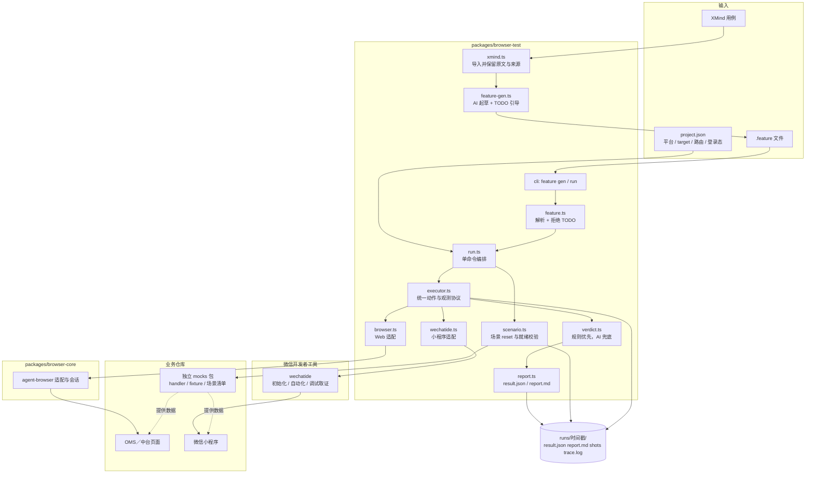
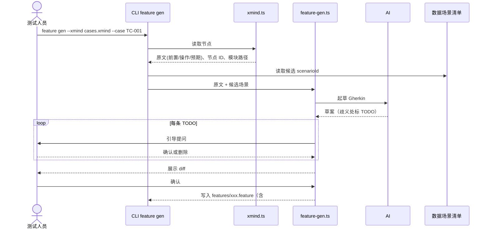
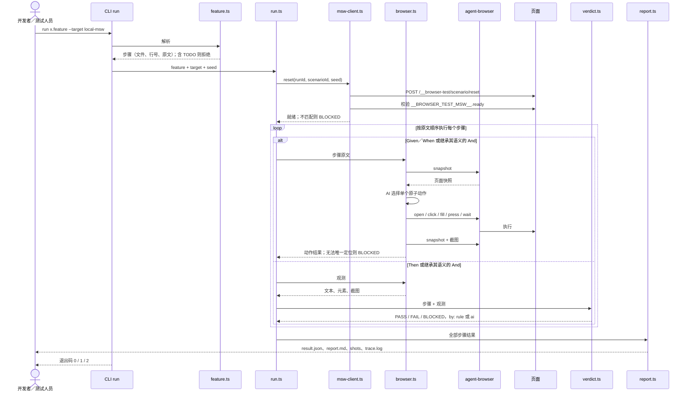
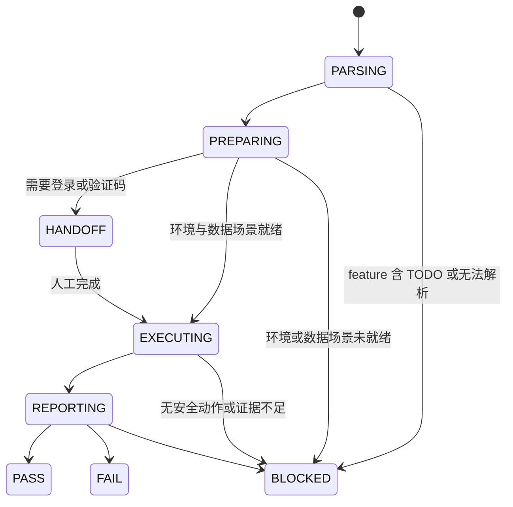

# browser-test 技术设计：Gherkin 驱动的 Web 与微信小程序测试

> 本文是 `browser-test` 的目标设计，也是从零实现的路线图。当前包只保留最小骨架（包配置、构建、`--help` 入口），文中所有能力均按第 9 章的步骤逐步实现，实现前不能当作现有 CLI 的使用说明。

## 1. 背景与目标

OMS／中台与微信小程序测试用例以 XMind 维护，开发联调和问题回归更适合直接运行可读的 Gherkin。把每条用例改写成测试代码接入成本高；纯自然语言 UI 执行又缺少稳定的数据、明确的断言口径和可信的结果。

`browser-test` 的做法是：**一个 `.feature` 文件 + 一条命令 + 一份可读报告**。

- XMind 用例经 AI 引导生成并由人确认，落成 `.feature`。
- 运行时由 AI 读取步骤，Web 通过 agent-browser、小程序通过微信开发者工具 `wechatide` 在真实运行时中操作和观测；mock target 通过业务仓库的场景适配器提供可复现数据。
- 确定性规则优先判定，AI 只负责动作选择和规则无法覆盖的局部语义判断；证据不足一律 BLOCKED。

核心原则：

- `.feature` 是唯一执行入口，步骤原文即断言口径，运行器不得改写步骤或放宽预期。
- 每次运行记录 feature 摘要、target 和 seed，结论只引用本次运行的实际页面证据。
- 操作前后均观测；写操作失败或结果不明时不自动重试。
- 配置、环境、登录或证据不满足时停止，并输出明确的阻塞原因。
- 默认产物只服务复现和排查，不预生成中间资产。

### 1.1 支持范围

聚焦 OMS／中台 Web 和微信开发者工具模拟器中的小程序。APP 用例可导入，但标记为不支持。

| target | 含义 | 用途 |
| --- | --- | --- |
| `local-msw` | 本地前端 + MSW 场景 | 联调自测、稳定问题回归 |
| `local-proxy` | 本地前端 + 真实测试后端 | 联调真实接口 |
| `online` | 线上或测试环境页面 | 只读断言优先 |
| `wechat-devtools-mock` | 微信开发者工具模拟器 + 小程序 mock 场景 | 小程序联调自测、稳定问题回归 |
| `wechat-devtools-live` | 微信开发者工具模拟器 + 真实测试后端 | 小程序真实接口联调 |

同一平台、业务语义一致的 feature 只切换 `--target` 即可运行；Web 与小程序交互或预期不同时使用独立 Scenario，不为追求跨端复用而放宽断言。mock 与 live 的结论分别标注，互不替代；后端落库、跨系统同步和真实授权结果必须引用 live 证据。

### 1.2 非目标

- 不引入 Cucumber 运行时和 step definition 代码。
- 不改变 `browser-opt` 的 Workflow 行为，不做 XMind 与 Workflow 的互转。
- 不恢复 `browser-e2e` 测试代码生成，不建设替代真实系统的演示业务系统。
- 不预先建设 PageModel、ExecutionPlan、数据清单、checkpoint 和批量执行；出现真实需求后再独立评估。
- 首期小程序范围限定为微信开发者工具模拟器，不把模拟器结论等同于真机微信、原生授权或设备能力验证。

## 2. 总体架构



| 位置 | 职责 |
| --- | --- |
| `packages/browser-test` | feature 生成与解析、运行编排、Web／小程序执行适配、判定、报告、CLI |
| `packages/browser-core` | agent-browser 适配、浏览器启动与会话等通用底层，构建时编译进各 CLI 的 `dist/browser-core`，不独立发布 |
| `packages/browser-opt` | 自然语言操作与 Workflow，保持现有边界 |
| `packages/browser-e2e` | 现有测试生成方向代码，本次不扩展 |
| 业务仓库独立 mocks 包 | Web 的 MSW handler、小程序场景适配器、fixture 和场景清单，与业务接口类型共同维护 |

技术栈：Node.js 24+、TypeScript、ESM、agent-browser、微信开发者工具 `wechatide`；按需引入 Zod（CLI 输入与配置校验）和 fflate（读取 XMind ZIP 中的 `content.json`），在对应步骤实现时再加入依赖。AI 调用经 Vercel AI Gateway。`wechatide` 按[微信开发者工具 Skills 官方文档](https://developers.weixin.qq.com/miniprogram/dev/devtools/Skills.html)接入，运行时读取当前安装版本随附的 Skill 和工具参数，不在包内复制固定工具清单。

## 3. 端到端时序

### 3.1 生成：XMind → .feature



### 3.2 执行：run（Web 示例）



### 3.3 执行：run（微信小程序）

小程序沿用相同的解析、逐步执行、判定与报告流程，只替换环境准备和执行适配器：

1. `wechatide.ts` 先调用 `check_devtools_status`，`--skill-version` 取自当前安装 `skill.yaml` 的 `version`；返回 `openid` 且无 `warning` 才继续，同一运行中不重复检查。同时校验开发者工具不低于 Nightly Electron Build 2.02.2607032，服务端口已开启；未登录或首次 `clientName` 授权弹窗进入 HANDOFF，未确认前不执行其他工具。
2. 打开前读取项目的 `project.config.json`，`appid` 缺失、为空或为 `touristappid` 时 BLOCKED，不自行补全；通过 `project_open_window` 打开项目，再用运行时信息工具核对当前项目、页面和运行时。
3. mock target 在打开业务页面前重置场景并校验 `runId`、`scenarioId`、版本和 seed；live target 明确记录真实数据来源。
4. 页面操作使用 automator 的导航、页面、元素和视口类工具；每个动作前后重新查询页面和目标元素。工具名与参数以安装包 `miniprogram-tools/references/tools.yaml` 的 `inputSchema` 为准，不凭记忆编写。
5. 失败时按需通过 debugger 类工具读取 console、network 并截图补充证据，不以刷新或重试掩盖原始失败。模拟器刷新成功不代表编译通过，场景 reset 或刷新后须用单文件编译工具校验，再进入业务步骤。

`browser-test` 运行器以命令行调用 `wechatide`（`-c <clientName> -t <tool> --<field> value`，object／array 参数通过 `--<field>-file` 传 JSON 文件，运行后清理临时文件），确保每次调用的工具和参数明确；`wechatide` 返回 `pending + taskId` 时保留任务信息并遵守官方异步任务协议。交互式 Agent 可按下方配置通过 MCP 直接使用同一组 DevTools 能力。登录等会阻塞执行的任务进入 HANDOFF；写操作、上传等动作不因超时或状态未知而重复发起。

### Agent MCP 配置（Copilot 与 Codex）

微信开发者工具 MCP 通过本机 `wechatide mcp` stdio 命令连接。先安装 Nightly Electron Build 2.02.2607032 或更新版本，登录开发者工具并开启服务端口，再到「设置 → 安全」复制带 Token 的配置；MCP Token 与 CLI 访问令牌、`clientName` 授权相互独立。首次连接仍需在开发者工具中授权对应 Agent。

- VS Code Copilot 使用仓库内 `.vscode/mcp.json`。配置会在连接时安全提示输入 MCP Token，不会把 Token 保存到仓库；若系统找不到 `wechatide`，将 `command` 改为终端中 `which wechatide` 返回的绝对路径。
- Codex 使用本机 `~/.codex/config.toml` 中的 `mcp_servers` 配置，不要把个人 Token 写入项目配置或提交到 Git。若该文件已存在 `wechat-devtools`，更新该项而不是重复添加；配置结构以微信开发者工具设置页复制内容为准。
- Copilot 与 Codex 使用相同的本机 DevTools 服务和授权，但各自读取不同的配置文件。修改配置后重载 VS Code 或重启 Codex 会话。

此 MCP 配置用于交互式 Agent 操作，不改变 `browser-test` 运行器优先通过 `wechatide` CLI 执行可复现用例的设计。

## 4. Feature 协议

### 4.1 生成规则

1. 导入：读取 XMind 节点的前置条件、操作、预期、节点 ID 和模块路径，保留原文，不改写。
2. 起草：前置条件 → Given，操作 → When，每条预期拆成独立 Then／And，模块路径 → Feature 名，数据前提 → 推荐 `@scenario:<scenarioId>`；已有 Web feature 的 `@msw` 保持兼容。
3. 引导确认：AI 不自行补全不确定的语义，而是留下 `# TODO(确认): …` 并在终端逐条提问。
4. 落盘：人工看 diff 后确认；文件头保留来源节点，便于回溯。

```gherkin
# source: cases.xmind#node-7f3a  商品管理/产品服务类型维护/列表页面
@case:TC-001 @target:local-msw @msw:serviceType.list.multiple
Feature: 产品服务类型列表

  Scenario: 列表页面字段与按钮展示校验
    Given 已登录并打开【商品管理-产品服务类型维护】页面
    And 页面存在已有的类型数据
    When 查看列表页面
    Then 列表展示“类型名称”“关联前台类目”“须上传资质文件数量”
    And 页面存在【新增】按钮
    And 每条记录存在【编辑】【删除】按钮
    # TODO(确认): “按钮具备停用操作”含义不明确，确认后改写为具体步骤或删除
```

约束：

- 含 `# TODO(确认)` 的 feature，`run` 拒绝执行并提示位置。
- 一条预期对应一个 Then／And，报告可逐条定位。
- 生成只依赖 XMind 原文与场景清单，不探查页面；定位留给执行阶段。
- `.feature` 提交到业务仓库，人工修改以它为准；XMind 更新后重新生成只输出差异，不覆盖已确认文件。
- 开发者也可以直接编写 feature，不必经过 XMind。

### 4.2 解析与标签

运行器解析 Feature、Scenario、Given、When、Then、And 和标签，每个步骤保留文件、行号与原文。

| 标签 | 含义 |
| --- | --- |
| `@case:<id>` | 对应的 XMind 用例编号 |
| `@target:<name>` | 默认 target，可被命令行 `--target` 覆盖 |
| `@scenario:<scenarioId>` | 与平台无关的数据场景；仅 mock target 生效 |
| `@msw:<scenarioId>` | 本场景需要的 MSW 数据场景，仅 `local-msw` 生效，其他 target 忽略并在报告注明使用真实数据 |

页面入口和登录态通过 `project.json` 解决，不另建页面模型。Web 配置 `baseUrl`、路由别名和登录态文件；小程序配置项目绝对路径、页面路由别名和 `wechatide` clientName，不保存或猜测 CLI access token。服务端口开启、`clientName` 授权和（若走 MCP）MCP Token 是三层独立校验，任一缺失都按 BLOCKED 或 HANDOFF 处理。

## 5. 运行时执行

### 5.1 动作规划

每个 Given／When 采用“观测 → 选择动作 → 执行单个原子动作 → 再观测”。执行器向 AI 提供统一的页面、候选元素和截图证据，再把动作映射到平台能力：

- Web 优先使用 URL、唯一文本、role、label 或 test id，执行 agent-browser 的 open、click、fill、press、wait 或 scroll。
- 小程序优先使用稳定测试标识、唯一选择器、文本和组件范围，执行 `wechatide` 的导航、元素操作、页面查询与滚动工具。普通页面与 tabBar 页面按各自导航能力处理。

无法唯一定位时 BLOCKED，并展示候选和截图，不允许猜测点击。每步重新获取观测，不依赖上一步的元素 ref 或 selector 查询结果。`page.data` 等内部状态可以辅助定位问题，但不能替代页面文本、元素状态或截图作为界面断言证据。

### 5.2 Then 判定

Then 只观测和判断，不产生业务写操作。

- 文本、数量、URL、可见性和结构化字段优先用确定性规则判定（`by: rule`）。
- 规则无法覆盖时由 AI 判断并标注 `by: ai`，报告单独高亮供人复核。
- 每个 Then 记录实际观测和截图；证据不足为 BLOCKED。
- 确定性 FAIL 不能被 AI 覆盖。

### 5.3 写操作与环境

- `local-msw` 和 `wechat-devtools-mock` 允许提交、删除等写操作；`online` 和 `wechat-devtools-live` 默认禁止，可由项目配置显式开放已审核场景。
- 写操作结果不明时停止，不自动重试。
- Web 登录、验证码或微信开发者工具登录需要人工完成时进入 HANDOFF，人工完成后继续，不形成额外结果类型；登录态按 target 隔离。微信业务登录、微信开发者工具登录和用户授权分别记录，不互相替代。

### 5.4 运行状态



结论只有 `PASS / FAIL / BLOCKED`。首期不建设 checkpoint，中断后用相同 feature、target 和 seed 重新运行。

## 6. 可复现数据场景协议

mock target 提供可复现的正常、边界、异常响应和状态迁移，只证明客户端在给定响应下的表现，不代表后端真实行为。

**落地决策：独立 mocks 包，最小化渗透业务仓库。**

- handler、fixture、平台适配器和场景清单放在独立 mocks 包，通过只读依赖接口类型包保证与真实接口一致。
- Web 业务仓库只在 dev 入口增加一处按开关加载的 MSW 引用，生产构建不打包。
- 小程序优先复用业务统一请求层的测试适配器；若项目无法提供稳定注入点，再使用仅测试环境可访问的 mock HTTP 服务。automator 的 wx API 模拟能力用于模拟微信 API 或少量受控分支，不默认承担完整业务请求 mock。
- Web 的 reset 端点与 `__BROWSER_TEST_MSW__` 就绪标记、小程序的场景 reset 与就绪查询均由 mocks 包提供，业务页面不自行拼装场景数据。
- 场景采用“AI 起草 + 人审入库”：AI 依据接口类型生成 handler 与 fixture，人工 review 后赋予稳定的 `scenarioId` 与默认 seed。运行只引用已入库场景，不在运行时现场生成数据。

Web 打开页面前，运行器调用仅限本地测试模式的端点：

```text
POST /__browser-test/scenario/reset
{
  "runId": "...",
  "scenarioId": "serviceType.list.multiple",
  "version": "1",
  "seed": 42,
  "parameters": { "count": 3 }
}
```

响应至少包含 `scenarioId`、版本、seed 和数据摘要；页面暴露 `__BROWSER_TEST_MSW__ = { runId, scenarioId, version, ready: true }`。运行器核对本地 origin、runId、scenarioId、版本与 ready，任何不匹配都在浏览器动作前 BLOCKED。

小程序 mock 使用相同的 reset 请求与返回字段，但由项目场景适配器暴露就绪查询；场景必须在首次业务请求前完成初始化。若小程序启动即请求数据，应提供仅测试构建启用的启动门禁或测试启动页。未匹配请求不得静默访问真实后端。每次运行独立重置，不继承前一次状态；Web 的 MSW 调用或小程序的场景调用写入 `trace.log`，摘要写入 `result.json`。

## 7. 命令、产物与退出码

```bash
browser-test feature gen --xmind cases.xmind --case TC-001 --out features/
browser-test run features/service-type-list.feature --target local-msw [--seed 42]
browser-test run features/service-type-list.feature --target local-proxy
browser-test run features/service-type-list.feature --target online
browser-test run features/service-type-list.feature --target wechat-devtools-mock [--seed 42]
browser-test run features/service-type-list.feature --target wechat-devtools-live
```

执行输出示例：

```text
[1/4] MSW   reset scenario serviceType.list.multiple (seed=42)   ok   3 条数据
[2/4] Given 已登录并打开…页面   agent-browser open /product-service-types   ok   shots/01.png
[3/4] When  查看列表            agent-browser snapshot                      ok   shots/02.png
[4/4] Then  …三列               PASS  表头: 类型名称 | 关联前台类目 | 须上传资质文件数量 | 操作
      And   【新增】按钮         PASS  button "新增" (e12)
      And   每条记录【编辑】【删除】  FAIL  第 3 行缺少“删除”   shots/03.png

Result: FAIL (2 passed, 1 failed)   report: runs/20261013-1612/report.md
```

运行目录只保留四类产物：

```text
runs/20261013-1612/
├── result.json   # 每步：text / status / by(rule|ai|action) / evidence / 耗时
├── report.md     # 人读：失败步骤置顶，附截图、实际文本、复现命令
├── shots/        # 01.png 02.png …（失败步骤必有）
└── trace.log     # agent-browser／wechatide 命令与数据场景调用的原始记录
```

```json
{
  "feature": "features/service-type-list.feature",
  "target": "local-msw",
  "platform": "web",
  "runtime": "browser",
  "dataMode": "mock",
  "scenario": { "id": "serviceType.list.multiple", "version": "1", "seed": 42, "ready": true },
  "status": "FAIL",
  "steps": [
    { "text": "Given 已登录并打开…页面", "status": "PASS", "by": "action", "shot": "shots/01.png" },
    { "text": "Then 列表展示…三列", "status": "PASS", "by": "rule", "actual": ["类型名称", "关联前台类目", "须上传资质文件数量", "操作"], "shot": "shots/02.png" },
    { "text": "And 每条记录都有【编辑】【删除】按钮", "status": "FAIL", "by": "rule", "actual": "第 3 行仅有【编辑】", "shot": "shots/03.png" }
  ],
  "rerun": "browser-test run features/service-type-list.feature --target local-msw --seed 42"
}
```

小程序结果使用相同结构，并在 `environment` 中记录项目路径摘要、当前页、Skill 版本关系、开发者工具版本、基础库版本和构建标识。无法取得的字段明确记为 unavailable，不推断或伪造；`runtime` 固定记录为 `devtools`，避免把模拟器结果误认为真机结果。

排查路径：看 `report.md` 的失败步骤 → 看截图与 `actual` → 需要时查 `trace.log`。退出码：`0 = PASS`，`1 = FAIL`，`2 = BLOCKED 或工具错误`。

## 8. 目标代码结构

| 模块 | 职责 |
| --- | --- |
| `types.ts` | Feature、Step、StepResult、RunResult、Target 等类型与配置 schema |
| `xmind.ts` | 读取 XMind，保留原文、节点 ID、模块路径 |
| `feature-gen.ts` | 起草 Gherkin，输出 `# source`、`@scenario` 推荐与 `# TODO(确认)` 引导 |
| `feature.ts` | 解析 Gherkin，保留文件与行号；拒绝含 TODO 的 feature |
| `project.ts` | 读取 `project.json`，解析平台、target、Web baseUrl、小程序项目路径、路由与登录态 |
| `executor.ts` | 定义跨平台的原子动作、页面观测、截图和执行结果协议 |
| `scenario.ts` | 定义跨平台场景 reset、就绪校验和数据摘要协议 |
| `msw-client.ts` | 实现 Web MSW 场景 reset 与 `__BROWSER_TEST_MSW__` 校验 |
| `wechat-scenario.ts` | 实现小程序请求层或 mock HTTP 场景 reset 与就绪校验 |
| `browser.ts` | 通过 browser-core 执行原子动作，采集快照与截图 |
| `wechatide.ts` | 调用微信开发者工具官方 Skills，完成环境门禁、小程序操作、观测与调试取证 |
| `verdict.ts` | 确定性规则优先，AI 判断兜底，统一输出 PASS／FAIL／BLOCKED |
| `report.ts` | 生成 `result.json`、`report.md` 与失败步骤摘要 |
| `run.ts` | 单命令串联解析、目标准备、执行、判定与报告 |
| `cli/browser-test.ts` | 命令入口与退出码 |

## 9. 实施步骤与验收

按顺序实现，每一步独立可验收；前一步未通过不进入下一步。

| 步骤 | 实现内容 | 最小验收 |
| --- | --- | --- |
| 1 | 类型与配置 schema、`project.json` 读取，区分 platform、runtime 和 dataMode | 构建、typecheck 通过；非法配置和不兼容组合被拒绝 |
| 2 | `feature.ts`：Gherkin 解析与 TODO 拒绝 | 步骤带行号；含 TODO 的 feature 被拒绝 |
| 3 | `executor.ts`、`browser.ts` 与 `report.ts`：统一执行协议、Web 原子动作、快照、截图、最小报告 | 对一个静态页面完成 open + snapshot，产出 `result.json` 与截图 |
| 4 | `verdict.ts` 与 `run.ts`：Then 规则判定、`run` 命令（先支持 `online` 只读） | 一份 feature 一条命令得到逐步结论；证据不足为 BLOCKED；退出码正确 |
| 5 | `xmind.ts` 与 `feature-gen.ts`：XMind → feature 引导生成 | 一条 XMind 用例经确认生成 feature 并可执行 |
| 6 | `msw-client.ts` 与 mocks 包场景：`local-msw` | 正常 fixture 稳定 PASS；注入“第三行缺按钮”稳定 FAIL；同 seed 可复现 |
| 7 | `local-proxy`、Web 登录态隔离与 HANDOFF、线上写操作限制 | 同一 feature 只切换 Web target 即可运行；报告标明 mock／live 范围 |
| 8 | `wechatide.ts`：官方状态门禁、项目打开、导航、元素操作、观测、截图与诊断证据 | 一个真实小程序列表页完成只读 live 流程；正常步骤 PASS、定位歧义 BLOCKED，报告可复现 |
| 9 | 小程序 mocks 场景适配器与 `wechat-devtools-mock` | 正常 fixture 稳定 PASS；故障 fixture 稳定 FAIL；同 seed 可复现；未匹配请求不访问 live |
| 10 | 小程序业务登录、微信开发者工具 HANDOFF、写操作限制与环境元数据 | 报告包含 Skill、开发者工具、基础库和构建版本；模拟器结论不标为真机结论 |
| 11 | 发布 Skill 与文档 | AI 助手可按 Skill 完成 Web 和小程序 feature 的生成与执行 |

首个 Web 纵向闭环选择一个真实、可本地启动的列表页面（如“产品服务类型维护”），在独立 mocks 包中建立其场景，打通 `XMind → feature → MSW → agent-browser → report`。小程序随后选择一个已在开发者工具稳定运行的真实列表页，打通 `feature → 场景 reset → wechatide → report`。两个闭环都必须包含正常与故障 fixture；仅有解析结果、类型定义、命令成功或模拟报告不算闭环完成。

## 10. 测试策略与风险控制

测试优先覆盖：feature 解析与 TODO 拒绝、数据场景 reset 协议、跨平台动作编排、Then 判定、报告结构与退出码，每一步实现时同步补充。

| 风险 | 控制 |
| --- | --- |
| 自然语言含义不明确 | 报告原文、候选和截图并 BLOCKED；稳定后再沉淀规则 |
| mock fixture 漂移 | 复用业务接口类型、CI 校验平台适配器、live 契约抽检 |
| `wechatide` 版本或工具参数变化 | 每次运行读取安装包随附 Skill；先检查 `versionRelation`，不在代码中写死未验证参数 |
| 小程序自定义组件无法稳定定位 | 提供稳定测试标识并限定组件范围；候选不唯一或不可见时 BLOCKED |
| 小程序启动请求早于场景 reset | 测试构建提供启动门禁或测试启动页；就绪身份不匹配时禁止进入业务动作 |
| 模拟器通过被当成真机通过 | 报告记录 runtime 为 devtools；授权、原生组件和设备能力另做真机验证 |
| mock 通过被当成真实通过 | mock、live 分别标注；live 缺数据不得降级为 mock 通过 |
| 页面缺陷被固化为预期 | 预期只来自 feature；页面实际结果只作为 actual |
| 页面元素 ref 变化 | 每步重新获取快照，优先 role、label、test id 与唯一文本 |
| 模型误判 | 确定性规则优先；AI 结论标注来源并保留证据 |
| 重复提交 | 写动作不自动重试；结果不明立即 BLOCKED |
| 产物膨胀 | 运行目录固定四类产物；新增资产必须证明排查确有需要 |

建设顺序固定为：先打通一个 `local-msw` Web 场景的可见闭环，再复用统一执行协议接入 `wechatide` 的只读 live 流程和 mock 场景，最后才评估真机、批量、跨系统和更严格的审计能力。工程验收要求类型检查、构建和测试通过，且不影响现有 browser-opt 命令、Workflow 与发布流程。
