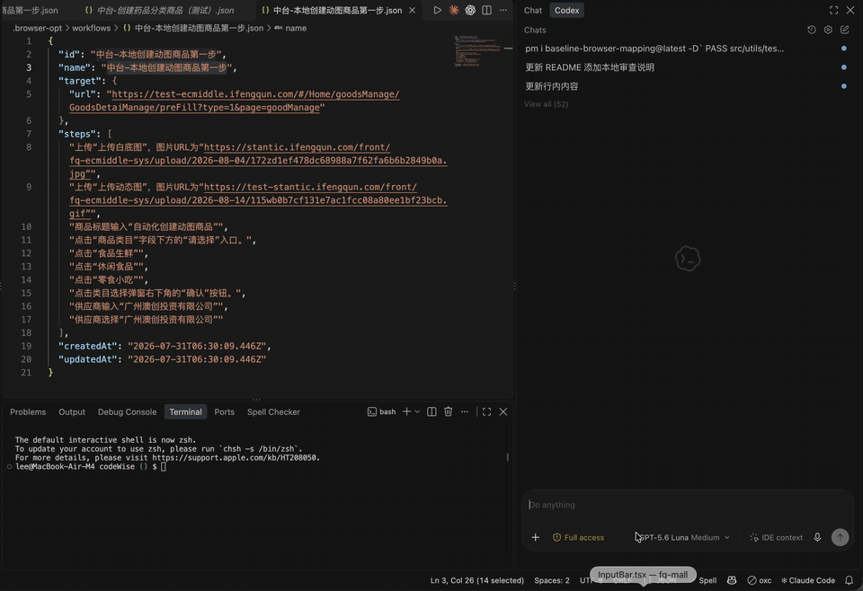
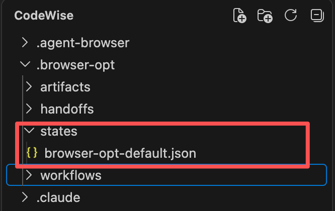
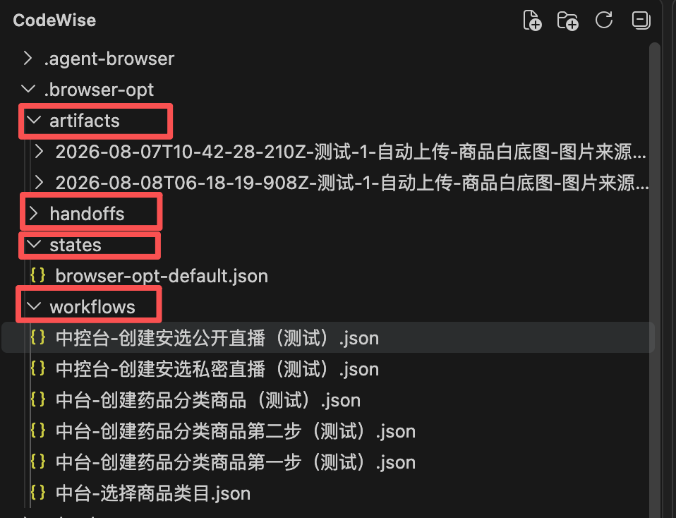
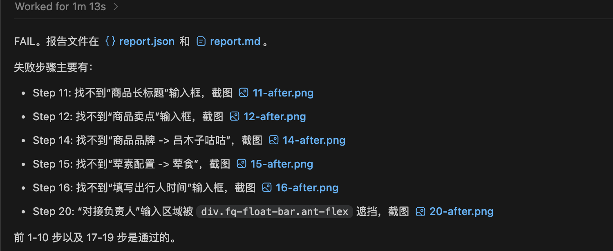
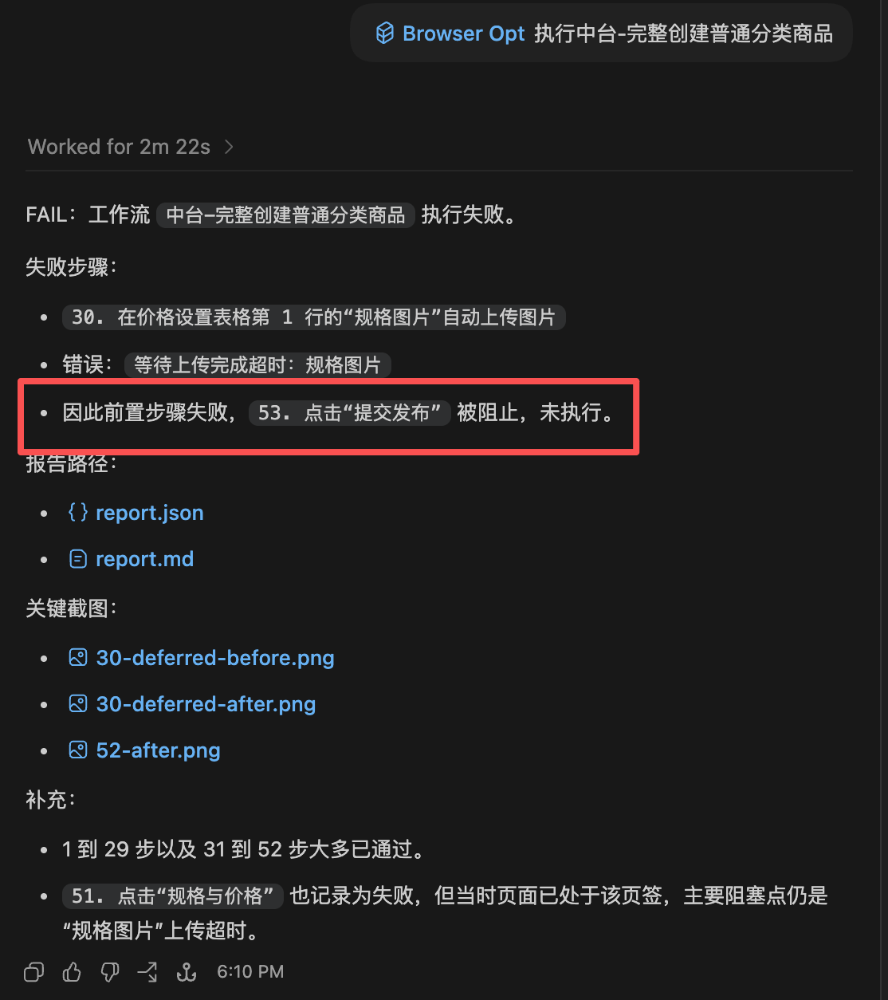

<!-- 本文件汇总 browser-opt 的安装、使用、运行产物及 Workflow 执行原理。 -->

# browser-opt

根据自然语言执行浏览器操作，保存和复用项目级 Workflow，并生成运行报告、截图、页面快照和日志。

## browser-opt 特性

| 特性 | 状态 | 说明 |
| --- | --- | --- |
| 自然语言即时执行 | ✅ 可用 | 用一段自然语言描述目标和步骤，立即在真实 Chrome 中执行 |
| Workflow 保存与复用 | ✅ 可用 | 将常用流程保存到项目中，后续用名称或短指令匹配并执行 |
| 登录态复用 | ✅ 可用 | 优先加载 State，失效后可回退到 Chrome Profile |
| 人工接管与恢复 | ✅ 可用 | 登录、验证码或本地文件选择等步骤可 handoff，完成后继续原运行 |
| 运行证据 | ✅ 可用 | 生成 PASS/FAIL 报告、日志、截图和页面结构快照 |
| 失败保护 | ✅ 可用 | 普通失败集中汇总；高影响操作在前置状态不确定时停止或跳过 |


## 调用方式速查

根据使用场景选择入口：

| 场景 | 调用方式 | 是否立即打开浏览器 |
| --- | --- | --- |
| 在 AI 助手中执行一次流程 | `/browser-opt <自然语言流程>` | 是 |
| 在终端执行一次流程 | `browser-opt "<自然语言流程>"` | 是 |
| 保存 Workflow | `browser-opt save "<名称>" --flow "<完整流程>"` | 否 |
| 执行已保存的 Workflow | `browser-opt run "<名称或短指令>"` | 是 |
| 查看已保存的 Workflow | `browser-opt list` | 否 |
| 检查当前版本 | `browser-opt --version` | 否 |
| 检查是否有新版本 | `browser-opt check-update --no-cache --json` | 否 |
| 更新工具及 Skill | `browser-opt update` | 否 |

最短的一次性调用示例：

```text
/browser-opt 测试 https://example.com。

目标：
1. 验证页面包含“Example Domain”。
2. 点击“More information”链接。
3. 验证跳转后的页面可以正常访问。
```

同一流程也可以直接通过 CLI 执行：

```bash
browser-opt "测试 https://example.com。验证页面包含 Example Domain。"
```

> [!TIP]
> 一次性任务使用即时执行；需要反复运行的流程保存为 Workflow；可能遇到登录、验证码或本地文件选择的流程，使用后台运行与 handoff，详见[人工接管与恢复](#人工接管与恢复)。

## 效果展示

下面展示了在 IDE 中通过 `browser-opt` 一键发起浏览器操作的完整过程：



## 安装与环境初始化

需要 Node.js 24 或更高版本，并确保系统已安装 Chrome。

### 临时试用

只想试用、不安装 CLI 和 Skill，可直接运行：

```bash
npx -y --registry=https://registry.npmjs.org/ -p browser-opt@latest -p agent-browser@latest browser-opt "
执行创建药品分类商品流程
目标：
1. 打开页面https://app-a.example.com/#/products/new?type=1
2. 商品标题输入“自动化创建药品分类商品”
"
```

### 安装

首次安装执行：

```bash
npx browser-opt@latest install --registry=https://registry.npmjs.org/
```

该命令会一次性安装或更新全局 `browser-opt`、`agent-browser` 及 `browser-opt` Skill。默认 Skill 目录为 `~/.agents/skills/browser-opt`，Codex、GitHub Copilot、Gemini CLI 和 Qoder 可共用，无需分别安装。Claude Code 使用自己的目录：

```bash
npx browser-opt@latest install --registry=https://registry.npmjs.org/ --agent claude
```

### 更新

后续更新所有已安装组件：

```bash
browser-opt update
```

如果安装时用了 `--agent claude`，更新时也传入同一参数。

```bash
browser-opt update --agent claude
```

`browser-opt update` 会优先更新当前正在执行这条命令的那份安装前缀，避免机器上存在多个全局前缀时把包装到别处。只有当当前 shell 仍解析到旧二进制、`update` 不可用，或你明确要绕过现有全局命令时，才回退到下面这条安装命令：

```bash
npx browser-opt@latest install --registry=https://registry.npmjs.org/
```

### 卸载

卸载首次安装写入的全局 CLI、运行时和 Skill：

```bash
browser-opt uninstall
```

如果安装时用了 `--agent claude`，卸载时也传入同一参数。

```bash
browser-opt uninstall --agent claude
```

只有确认要删除当前项目的 `.browser-opt` 登录态、报告和 handoff 记录时，卸载才追加 `--all-data`。

```bash
browser-opt uninstall --all-data
```

### 环境说明

`install`、`update` 和试用命令默认使用系统标准 Chrome，不会下载 Chrome for Testing。机器没有标准 Chrome 且接受测试浏览器时，安装或更新可追加 `--download-browser`；试用前则需自行准备 Chrome。若执行 `install` 或 `update` 后 shell 仍指向旧的 `browser-opt`，请按命令输出提示调整 PATH 或重开终端。

Linux 无桌面或缺少浏览器系统库，并明确使用下载浏览器时：

```bash
npx browser-opt@latest install --registry=https://registry.npmjs.org/ --download-browser --with-deps
```

`install`（`setup` 保留为兼容别名）还支持 `--skills-dir <目录>` 自定义 Skill 根目录、`--skip-skill` 只处理运行时，以及 `--skip-runtime` 只安装 Skill。Skill 每次执行前会用 `browser-opt check-update --json` 轻量检查新版本。

## 使用

### 一次性执行

```bash
browser-opt "测试 https://example.com 的搜索功能。

目标：
1. 打开首页。
2. 验证页面包含 \"Example\"。"
```

### 保存并复用 Workflow

```bash
browser-opt save "示例首页验证流程" --flow "测试 https://example.com。\n1. 验证页面包含 \"Example\"。"
browser-opt run "执行示例首页验证流程"
```

也可以完全通过 Skill 保存和执行。保存请求只会写入 Workflow，不会打开浏览器或立即执行：

```text
/browser-opt 把下面的流程保存为“示例首页验证流程”，先不要执行。

目标页面：https://example.com

目标：
1. 验证页面包含“Example Domain”。
2. 点击“More information”链接。
3. 验证跳转后的页面可以正常访问。
```

保存成功后，用一句话执行：

```text
/browser-opt 执行示例首页验证流程
```

Workflow 默认保存到调用项目的 `.browser-opt/workflows/`；运行证据默认保存到 `.browser-opt/artifacts/`。

例如，`.browser-opt/workflows/示例首页验证流程.json` 的内容如下：

```json
{
  "id": "示例首页验证流程",
  "name": "示例首页验证流程",
  "target": {
    "url": "https://example.com"
  },
  "steps": [
    "验证页面包含\"Example Domain\"。",
    "点击\"More information\"链接。",
    "验证跳转后的页面可以正常访问。"
  ],
  "createdAt": "2026-10-09T08:00:00.000Z",
  "updatedAt": "2026-10-09T08:00:00.000Z"
}
```

`id` 必须与 JSON 文件名一致；`target.url` 已表示需要打开的页面，因此 `steps` 只需填写页面打开后的操作和验证步骤。

### Workflow 查询与匹配

列出当前项目保存的 Workflow：

```bash
browser-opt list
```

只匹配 Workflow、不启动浏览器：

```bash
browser-opt match "执行示例首页验证流程" --json
```

匹配结果唯一时可以直接用 `run` 执行；存在多个相似结果时，应先确认目标 Workflow，避免误跑流程。

### 人工接管与恢复

可能遇到登录、验证码或本地文件选择的流程，可以在后台启动并保留稳定的 `runId`：

```bash
browser-opt start --flow "<完整自然语言流程>" --json
browser-opt status --run-id "<runId>" --json
```

`status` 返回 `HANDOFF` 后，由操作者在真实 Chrome 中完成提示的操作，再恢复原运行：

```bash
browser-opt resume --run-id "<runId>" --json
browser-opt status --run-id "<runId>" --json
```

后台运行状态含义如下：

| 状态 | 含义 | 后续操作 |
| --- | --- | --- |
| `RUNNING` | 流程仍在自动执行 | 继续查询 `status` |
| `HANDOFF` | 正在等待人工操作 | 完成提示的操作后调用 `resume` |
| `PASS` | 流程执行成功 | 查看报告与证据 |
| `FAIL` | 流程执行失败 | 根据报告、日志和截图排查 |

如果需要主动终止仍在运行的后台任务：

```bash
browser-opt stop --run-id "<runId>" --json
```

## 登录态复用

执行需要鉴权的流程时，`browser-opt` 会优先复用已经保存的登录凭证，通常不需要重复登录。只有凭证确实失效且 Chrome Profile 也无法直接恢复时，流程才会进入 handoff，等待操作者在真实 Chrome 中完成登录；恢复后，工具会保存新的登录态并继续原流程。

### 核心思路

系统把登录凭证保存为轻量的 State 文件，其中只包含 cookies 和 Web Storage，不包含历史标签页。State 默认保存在项目的 `.browser-opt/states/` 目录中。每次执行先尝试加载 State；State 不存在时从 Chrome Profile 初始化；默认 State 失效时则回退一次 Chrome Profile，必要时再进入人工接管。



### 三条复用路径

**路径 A：已有 State 文件（最快）**

先打开空白页并加载 cookies 和 storage，再打开目标页。登录态会在目标页首批请求发出前完成恢复，避免页面先以未登录状态加载。

**路径 B：没有 State 文件（首次运行）**

使用 Chrome Profile 直接打开目标页。页面确认不在登录页且已正常渲染后，立即将当前 cookies 和 storage 保存为 State，后续运行自动转为路径 A。

**路径 C：默认 State 已失效（回退）**

关闭当前 State 窗口并切换到指定的 Chrome Profile，然后重新打开目标页。若仍停留在登录页，工具会尝试聚焦账号或密码输入框，以便 Chrome 展示已保存的凭证；仍无法恢复时进入 handoff。操作者完成登录并恢复流程后，工具会等待页面离开登录页，再保存新的 State 并继续执行。每轮运行最多回退一次，不会在 State 和 Profile 之间反复切换。

> [!NOTE]
> 自动 Profile 回退只适用于默认 State。显式传入 `--state <path>` 时，工具会严格使用该文件，不会自动切换 Profile。可用 `--profile <name>` 选择首次初始化和默认回退所使用的 Chrome Profile。

每次调用仍会使用全新的 browser session，避免继承旧标签页、表单内容或 Chrome 恢复页面；复用的是登录凭证，而不是上一次的浏览器窗口。

## 文件产物

所有默认路径均相对于执行命令时的当前项目目录：

```text
.browser-opt/
  workflows/
    <workflow-id>.json
  states/
    browser-opt-<profile>.json
    browser-opt-sessions.json
  handoffs/
    <run-id>/
      run.json
      output.log
      resume.signal
  artifacts/
    <本次运行目录>/
      report.json
      report.md
      run.log
      *.png
      *.snapshot.json
```

| 内容 | 默认路径 | 是否重要 | 作用与处理建议 |
| --- | --- | --- | --- |
| Workflow 文件 | `.browser-opt/workflows/<流程名称>.json` | 重要 | 保存可复用工作流；可提交到代码库或分享给其他人 |
| 登录状态 | `.browser-opt/states/` | 重要且敏感 | 保存 cookies、storage 和托管 session 记录；不要提交到代码库或分享 |
| 执行报告与截图 | `.browser-opt/artifacts/<本次运行目录>/` | 临时证据 | 用于复盘和排查；报告 Bug 时应发送对应运行目录的完整内容 |
| 人工接管记录 | `.browser-opt/handoffs/<run-id>/` | 临时状态 | 保存后台任务元数据、输出和恢复信号；任务结束且无需排查时可清理 |



每次运行的证据目录通常包含：

- `report.md`：便于人工阅读的执行报告
- `report.json`：供程序读取的结构化执行结果
- `run.log`：完整执行日志
- `*.png`：初始页面及各步骤执行前后的截图
- `*.snapshot.json`：各阶段的页面结构快照
- `uploads/`：存在远程文件上传步骤时下载的临时文件

普通步骤失败时，工具会在流程结束后汇总失败步骤、错误原因和对应截图；仍可安全执行的低风险步骤可以继续。报告和图片都保存在 `.browser-opt/artifacts/<本次运行目录>/`，便于回看页面状态和定位阻塞点。



对于导出、删除、提交、发布等高影响操作，只要前置步骤出现阻塞性失败，该操作就会被跳过；高影响步骤自身失败时也会立即停止后续操作，防止在页面状态不确定时继续产生副作用。



当运行证据超过 10 份，或 `artifacts` 与已结束的 `handoffs` 合计超过 500 MB 时，CLI 会给出按时间排序的清理建议，但不会自动删除文件。确认运行正常且不再需要排查后，可以手动清理对应的临时目录；不要删除仍需复用的 Workflow 和 State。

## browser-opt 与 agent-browser 如何协作

browser-opt 负责理解 Workflow 步骤、匹配页面元素并判断结果，agent-browser 负责读取真实页面和执行确定性浏览器操作；常规元素无法识别时，browser-opt 会借助 agent-browser 在字段上下文内查询 DOM 进行兜底。

例如，Workflow 步骤为“在‘直播间名称’输入‘周五新品发布’”时，协作过程如下：

1. browser-opt 从自然语言中识别出操作类型是“输入”、目标字段是“直播间名称”、输入值是“周五新品发布”。
2. browser-opt 请求 agent-browser 读取当前页面；agent-browser 返回可交互元素列表，并为当前页面中的元素提供 `e1`、`e2` 等临时引用，例如 `textbox "直播间名称" [ref=e1]`，执行命令时该引用写作 `@e1`。
3. browser-opt 先筛选输入框类型的元素，再用字段文案“直播间名称”匹配元素的名称、标签或占位提示，优先采用准确或包含关系匹配，再用保守的字符匹配兜底；匹配到 `ref=e1` 后，将其确定为本步骤的目标元素。这个 ref 来自 agent-browser 返回的当前页面结构，不是 browser-opt 猜测的 CSS 选择器。
4. browser-opt 把“向 `@e1` 填写‘周五新品发布’”这一明确操作交给 agent-browser，agent-browser 再在真实浏览器中执行输入。
5. 如果执行时发现 `@e1` 已失效，browser-opt 会重新读取页面并再次匹配；同一个输入框此时可能获得新的 ref，例如 `@e7`，随后使用新 ref 重试一次。
6. 输入成功后，browser-opt 再次读取页面，按“直播间名称”重新找到当前输入框并检查其值是否为“周五新品发布”；验证未通过时直接返回失败，避免重复填写。
7. 如果常规页面结构始终没有暴露该输入框，browser-opt 会让 agent-browser 在真实 DOM 中查找“直播间名称”所在表单区域内的可编辑元素；定位成功后执行输入，无法可靠定位则返回失败。


### 1. browser-opt 负责识别和决策

browser-opt 先把 Workflow 中的自然语言步骤整理成明确的“操作类型、操作目标和操作值”。例如：

- “在直播间名称输入‘自动化测试直播间’”会被理解为：向“直播间名称”输入指定内容。
- “点击‘下一步’”会被理解为：查找并点击文案为“下一步”的可点击元素。
- “验证页面包含‘创建成功’”会被理解为：操作完成后检查页面是否出现目标文案。

识别出操作后，browser-opt 再结合页面元素的文案、控件类型、可用状态以及所在字段，选择最符合目标的元素。存在多个相似元素时会优先使用字段上下文缩小范围，避免只按全页面文案随意选择。

### 2. agent-browser 负责读取和执行

agent-browser 是 browser-opt 与真实浏览器之间的执行层，主要承担两类工作：

- 读取当前页面，把可交互元素及其文案、控件类型和状态提供给 browser-opt。
- 接收 browser-opt 已经确定的操作，完成打开页面、点击、输入、选择或上传等浏览器动作。

两者的分工可以概括为：browser-opt 决定“要做什么、操作哪个元素、结果是否正确”，agent-browser 负责“读取真实页面并把确定的操作执行出来”。

### 3. DOM 元素识别兜底

部分业务页面使用自定义表单、伪按钮、隐藏上传控件等组件，这些元素可能不会完整出现在常规页面结构中。此时 browser-opt 会通过 agent-browser 查询真实 DOM，作为元素识别的补充手段。

DOM 兜底会先找到目标字段的标题或说明，再把搜索范围限制在同一表单区域及其邻近结构中。点击、输入和选择只使用可见、可用且符合目标文案或控件类型的元素；上传场景则可以在字段范围内找到组件隐藏的真实文件输入控件。定位成功后，仍由 agent-browser 执行具体操作；无法可靠定位时则返回失败，不会在整个页面中盲目点击或输入。

### 4. 失败后的协作重试

如果元素定位失效或出现可恢复的执行错误，browser-opt 会要求 agent-browser 重新读取最新页面，放弃旧的元素定位结果，再根据新页面重新识别目标并重试一次。重试仍失败时结束该步骤；如果动作已执行但页面验证未通过，则直接返回失败，避免重复操作。